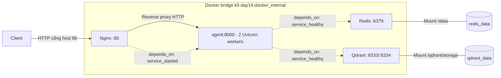

# Day 14 Lab - Mission Answers

## Part 1: Localhost vs Production

### Exercise 1.1: Anti-patterns found

1. **AP-01 — Hardcoded credentials.** `01-localhost-vs-production/develop/app.py:15-18` đặt API key mẫu và URL database có thông tin đăng nhập trực tiếp trong source. Nếu dùng credential thật, người đọc repo hoặc lịch sử Git có thể lấy được chúng. Production đọc các key từ environment tại `production/config.py:26-32`; vẫn cần quản lý secret an toàn bên ngoài code.
2. **AP-02 — Logging sensitive information.** `develop/app.py:31-38` in cả câu hỏi và biến API key. Log có thể bị thu thập hoặc chia sẻ và làm lộ thông tin nhạy cảm. `production/app.py:110-122` ghi độ dài câu hỏi và response, không ghi key hay nội dung câu hỏi trong các event này. Không suy ra mọi log production đều hợp lệ hoặc an toàn.
3. **AP-03 — Missing health/readiness endpoints.** `develop/app.py:25-39` chỉ khai báo `/` và `/ask`; `develop/app.py:42-43` cũng nêu thiếu health check. Thiếu probe chuyên dụng làm platform khó kiểm tra trạng thái process và mức sẵn sàng. `production/app.py:135-161` có `/health` và `/ready`; readiness ở đây chỉ dựa vào cờ nội bộ, chưa kiểm tra dependency ngoài.
4. **AP-04 — Hardcoded host and port.** `develop/app.py:47-53` cố định host loopback và port 8000. Service có thể không nhận kết nối từ bên ngoài môi trường chạy hoặc không nghe port platform cấp. Production đọc `HOST` và `PORT` từ environment tại `production/config.py:16-19` và dùng chúng ở `production/app.py:192-198`.
5. **AP-05 — Auto reload always enabled.** `develop/app.py:49-53` đặt `reload=True`; file watcher có thể gây restart ngoài dự kiến trong môi trường vận hành. Production chỉ bật reload khi `DEBUG=true`, mặc định false: `production/config.py:19`, `production/app.py:192-198`.
6. **AP-06 — Hardcoded application configuration.** `develop/app.py:20-22` đặt cố định `DEBUG` và `MAX_TOKENS`, gây khó thay cấu hình giữa các môi trường. Hai biến này không thấy được dùng trong request handler develop, nên không kết luận chúng đã gây lỗi runtime. Production định nghĩa cấu hình tương ứng từ environment tại `production/config.py:19-29`.

Đường dẫn `develop/` và `production/` viết tắt ở trên đều thuộc `01-localhost-vs-production/`.

### Exercise 1.2: Development runtime testing

Người dùng chạy từ `01-localhost-vs-production/develop`:

```bash
../../.venv/bin/python app.py
```

Startup thực tế: Uvicorn lắng nghe `localhost:8000`; reloader PID 11079, server PID 11097; application startup hoàn tất.

| ID | Request | Expected | Actual | Response thực tế | Kết quả |
| --- | --- | --- | --- | --- | --- |
| TC-01 | `GET /` | 200 | 200 | `{"message":"Hello! Agent is running on my machine :)"}` | PASS |
| TC-02 | `POST /ask?question=Hello` | 200 | 200 | `{"answer":"Tôi là AI agent được deploy lên cloud. Câu hỏi của bạn đã được nhận."}` | PASS |
| TC-03 | `POST /ask`, JSON `{"question":"Hello"}` | 422 | 422 | `{"detail":[{"type":"missing","loc":["query","question"],"msg":"Field required","input":null}]}` | PASS |
| TC-04 | `GET /health` | 404 | 404 | `{"detail":"Not Found"}` | PASS |
| TC-05 | `GET /ready` | 404 | 404 | `{"detail":"Not Found"}` | PASS |

Development HTTP tests: **5/5 PASS**. Người dùng đã dừng develop và xác nhận port 8000 không còn listener trước khi chạy production.

Theo `develop/app.py:30-31`, `question` là query parameter, tức nằm trên URL; JSON body là dữ liệu trong thân request và không thay thế tham số query bắt buộc này. Vì vậy TC-03 trả 422 cho input thiếu theo contract, còn 404 ở TC-04/05 cho biết các route đó không tồn tại ở develop. Cả hai bản gọi Mock LLM cục bộ; response có thể thay đổi do lựa chọn ngẫu nhiên (`develop/utils/mock_llm.py:21-32`).

### Exercise 1.3: Comparison table

Các nhận định trong bảng là phân tích **source**; kết quả thực tế được ghi riêng ở các test case bên dưới và tại Exercise 1.2.

| Feature | Develop | Production | Why Important? |
|---|---|---|---|
| Configuration | Giá trị đặt trong `develop/app.py:20-22`. | `production/config.py:14-29` đọc environment. | Cấu hình theo môi trường không cần sửa source; hai biến mẫu develop không thấy được dùng trong handler. |
| Secret management | Key và thông tin kết nối mẫu nằm trong source: `develop/app.py:15-18`. | Key đọc từ environment: `production/config.py:26-32`. | Tránh đưa credential thật vào code và lịch sử Git; đọc env không tự bảo đảm xác thực API. |
| Logging | `print` câu hỏi và key: `develop/app.py:31-38`. | Log event gồm độ dài và client IP: `production/app.py:27-32,110-122`. | Hạn chế lộ nội dung; formatter có dạng JSON nhưng không thể khẳng định mọi dòng là JSON hợp lệ. |
| Network binding | `localhost:8000` cố định: `develop/app.py:47-53`. | Host/port từ config, mặc định `0.0.0.0:8000`: `production/config.py:17-18`, `production/app.py:192-197`. | Giúp service nhận kết nối và dùng port do môi trường cấp. |
| Auto reload | Luôn bật khi chạy file: `develop/app.py:49-53`. | Theo `DEBUG`, mặc định tắt: `production/config.py:19`, `production/app.py:198`. | Tránh tự restart do thay đổi file khi vận hành. |
| Request contract | `POST /ask` nhận query, response chứa `answer`: `develop/app.py:29-39`. | `POST /ask` đọc JSON và trả `question`, `answer`, `model`: `production/app.py:102-128`. | Client cần gửi đúng định dạng; contract sai dẫn tới lỗi thay vì kết quả mong đợi. |
| Health check | Không khai báo `/health`: `develop/app.py:25-43`. | `GET /health`: `production/app.py:135-149`. | Probe giúp theo dõi process còn đáp ứng. |
| Readiness check | Không khai báo `/ready`: `develop/app.py:25-43`. | `GET /ready` dựa trên cờ lifecycle: `production/app.py:35-36,152-161`. | Giúp quyết định route traffic; cờ nội bộ chưa chứng minh dependency ngoài sẵn sàng. |
| Metrics | Không khai báo `/metrics`: `develop/app.py:25-43`. | `GET /metrics` trả JSON uptime, environment, version: `production/app.py:164-173`. | Cung cấp thông tin quan sát cơ bản; response không phải Prometheus exposition format. |
| Lifecycle management | Không có lifespan do ứng dụng khai báo: `develop/app.py:13-54`. | Có lifespan startup/shutdown và handler SIGTERM: `production/app.py:39-67,180-189`. | Cho phép chuẩn bị và dọn dẹp tài nguyên; hành vi graceful đầy đủ cần kiểm thử riêng. |

#### Production startup và HTTP evidence

Người dùng quan sát warning `OPENAI_API_KEY not set — using mock LLM`, `Started server process [12757]`, `Waiting for application startup.`, `Application startup complete.` và Uvicorn lắng nghe `http://0.0.0.0:8000`. Không quan sát thấy reloader process.

| ID | Request | Expected | Actual | Response thực tế | Kết quả |
| --- | --- | --- | --- | --- | --- |
| TC-06 | `GET /` | 200 | 200 | `{"app":"AI Agent","version":"1.0.0","environment":"development","status":"running"}` | PASS |
| TC-07 | `POST /ask`, JSON `{"question":"Hello"}` | 200 | 200 | `{"question":"Hello","answer":"Agent đang hoạt động tốt! (mock response) Hỏi thêm câu hỏi đi nhé.","model":"gpt-4o-mini"}` | PASS |
| TC-08 | `POST /ask`, JSON `{}` | 422 | 422 | `{"detail":"question field is required"}` | PASS |
| TC-09 | `GET /health` | 200 | 200 | `{"status":"ok","uptime_seconds":35.9,"version":"1.0.0","environment":"development","timestamp":"2026-11-26T07:34:35.024017+00:00"}` | PASS |
| TC-10 | `GET /ready` | 200 | 200 | `{"ready":true}` | PASS |
| TC-11 | `GET /metrics` | 200 | 200 | `{"uptime_seconds":35.9,"environment":"development","version":"1.0.0"}` | PASS |

Production HTTP tests: **6/6 PASS**.

#### Production shutdown evidence

Người dùng nhấn Ctrl+C. Log ghi `Shutting down`, `Waiting for application shutdown.`, `Application shutdown complete.` và `Finished server process [12757]`. Sau đó xuất hiện traceback gồm `asyncio.exceptions.CancelledError` và `KeyboardInterrupt`. Hai lần kiểm tra `ss -ltnp | grep ':8000'` đều không có output.

| Hạng mục | Kết quả |
| --- | --- |
| Application shutdown lifecycle | PASS |
| Server termination và giải phóng port 8000 | PASS |
| Shutdown không có exception | WARNING: có traceback sau log shutdown |
| Exit code | Chưa xác minh |
| Graceful shutdown bằng SIGTERM | Chưa kiểm thử |
| Hoàn tất request đang xử lý khi shutdown | Chưa kiểm thử |
| Nguyên nhân traceback | Chưa xác minh |

Các bằng chứng trên chưa chứng minh graceful shutdown toàn diện.

### Part 1 — Test summary

- Development: **5/5 PASS**; Production: **6/6 PASS**.
- Tổng: **11/11 HTTP tests PASS**, tương đương **100% trong phạm vi các test đã thực hiện**.

### Limitations

- Chưa cloud deployment; cả hai phiên bản sử dụng Mock LLM. Nhãn `gpt-4o-mini` trong response không chứng minh OpenAI API đã được gọi.
- Source bản production chạy với runtime environment `development`; endpoint `/ask` của Part 1 chưa xác thực API key.
- Readiness chưa kiểm tra external dependencies; metrics chưa ở Prometheus exposition format.
- Shutdown lifecycle và port release PASS; exception-free shutdown WARNING. Exit code, SIGTERM, hoàn tất request đang xử lý và nguyên nhân traceback chưa được xác minh.

## Part 2: Docker

### Exercise 2.1: Dockerfile questions

1. **Base image.** Development dùng `python:3.11` với một stage. Production dùng `python:3.11-slim` cho cả hai stage `builder` và `runtime`. [Development Dockerfile dòng 8](02-docker/develop/Dockerfile#L8), [Production Dockerfile dòng 16 và 36](02-docker/production/Dockerfile#L16-L36).
2. **Working directory.** `WORKDIR /app` đặt thư mục làm việc trong container cho các instruction tiếp theo và lệnh khởi động mặc định. Production đặt `WORKDIR /app` trong cả hai stage. [Development Dockerfile dòng 11](02-docker/develop/Dockerfile#L11), [Production Dockerfile dòng 18 và 42](02-docker/production/Dockerfile#L18-L42).
3. **Vì sao copy requirements trước source.** Development copy `requirements.txt`, chạy `pip install --no-cache-dir`, rồi mới copy `app.py` và mock LLM. Khi chỉ sửa source, Docker có thể tái sử dụng layer cài dependencies nếu các đầu vào và layer trước đó vẫn khớp. Khi requirements thay đổi, layer `COPY` tương ứng và bước cài đặt phía sau phải được tính lại. `--no-cache-dir` tắt cache của pip, còn Docker vẫn có thể lưu và tái sử dụng layer của bước `RUN`. Production cũng cài requirements ở builder trước khi copy source vào runtime. [Development Dockerfile dòng 13–24](02-docker/develop/Dockerfile#L13-L24), [Production Dockerfile dòng 26–52](02-docker/production/Dockerfile#L26-L52).
4. **CMD và ENTRYPOINT.** `ENTRYPOINT` xác định chương trình khởi động chính. Khi dùng dạng exec của cả hai instruction, `CMD` cung cấp đối số mặc định cho `ENTRYPOINT`. Nếu không có entrypoint, `CMD` cung cấp lệnh mặc định. Đối số sau tên image trong `docker run` thay thế `CMD`, còn `--entrypoint` ghi đè entrypoint. Cả hai Dockerfile đều không khai báo `ENTRYPOINT` tường minh. Development dùng `CMD ["python", "app.py"]`, production dùng `CMD` chạy Uvicorn với hai workers. [Development Dockerfile](02-docker/develop/Dockerfile#L8-L30), [Production Dockerfile](02-docker/production/Dockerfile#L16-L72).

Development dùng user mặc định kế thừa từ base image và không khai báo Docker `HEALTHCHECK`. Ứng dụng vẫn cung cấp HTTP endpoint `/health`. [Development Dockerfile dòng 8–30](02-docker/develop/Dockerfile#L8-L30), [Development app.py dòng 25–31](02-docker/develop/app.py#L25-L31).

Dấu `.` trong hai lệnh build chỉ build context ở gốc repo. Nguồn của `COPY` được tra theo context này, gồm các đường dẫn dưới `02-docker/` và `utils/mock_llm.py`. Root `.dockerignore` lọc các mục khớp quy tắc trước khi gửi context cho builder, giúp giảm dữ liệu truyền và tránh đưa các mục như virtualenv, Git metadata hoặc tệp môi trường bị loại vào build context. Cấu hình có ngoại lệ cho `.env.example`. [Development Dockerfile dòng 13–24](02-docker/develop/Dockerfile#L13-L24), [Production Dockerfile dòng 26–52](02-docker/production/Dockerfile#L26-L52), [Root .dockerignore](.dockerignore#L1-L38).

### Exercise 2.2: Build và run

Lệnh build đã chạy từ gốc repo.

```bash
docker build -f 02-docker/develop/Dockerfile -t my-agent:develop .
```

Build hoàn tất `12/12 FINISHED` trong 253.4 giây. Image ID `2a429c36234e`, platform `linux/amd64`, kích thước chính xác 1667788057 bytes. `docker images` hiển thị disk usage 1.67 GB và content size 426 MB.

```bash
docker run -d --rm \
  --name k5-day14-cp2-develop \
  -p 127.0.0.1:8000:8000 \
  my-agent:develop
```

Container ID `f5e7268fc2c3`, command `python app.py`, trạng thái `Status=running Running=true`. Log ghi server PID 1, `Application startup complete` và Uvicorn lắng nghe tại `http://0.0.0.0:8000`. Host mapping là `127.0.0.1:8000 -> 8000/tcp`.

#### TC-CP2-01 — Health trực tiếp

```bash
curl -i http://127.0.0.1:8000/health
```

Thực tế trả về **HTTP 200 OK** lúc 08:08:36 GMT ngày 2026-11-26.

```json
{"status":"ok","uptime_seconds":83.6,"container":true}
```

#### TC-CP2-02 — Agent trực tiếp

```bash
curl -i -X POST 'http://127.0.0.1:8000/ask?question=Hello'
```

Thực tế trả về **HTTP 200 OK** lúc 08:08:36 GMT ngày 2026-11-26. Bản development nhận `question` qua query string. [Development app.py dòng 20–22](02-docker/develop/app.py#L20-L22).

```json
{"answer":"Agent đang hoạt động tốt! (mock response) Hỏi thêm câu hỏi đi nhé."}
```

Access log thu trước khi dừng container.

```text
INFO: 172.17.0.1:59442 - "GET /health HTTP/1.1" 200 OK
INFO: 172.17.0.1:59456 - "POST /ask?question=Hello HTTP/1.1" 200 OK
```

**2/2 PASS.** Lệnh `docker stop k5-day14-cp2-develop` thành công. Docker tự xóa container do dùng `--rm` và giữ lại image. Sau cleanup, WSL không còn listener trên cổng 8000 và Git working tree vẫn sạch. Log được thu trước khi dừng nên bằng chứng này chỉ xác nhận container đã dừng và cổng được giải phóng.

### Exercise 2.3: Image size comparison

Lệnh build production đã chạy từ gốc repo.

```bash
docker build -f 02-docker/production/Dockerfile -t my-agent:advanced .
```

Build hoàn tất `17/17 FINISHED` trong 159.9 giây. Image ID `d236840ef7fa`. `docker images` hiển thị disk usage 240 MB và content size 57.4 MB.

| Chỉ số | Development | Production |
| --- | --- | --- |
| Base image | `python:3.11` | `python:3.11-slim` |
| Số build stages | 1 | 2 |
| Kích thước chính xác (bytes) | 1667788057 | 239815445 |
| Kích thước theo MB thập phân | 1667.79 | 239.82 |
| Disk usage hiển thị | 1.67 GB | 240 MB |
| Content size | 426 MB | 57.4 MB |
| Thời gian build | 253.4 s | 159.9 s |
| User | User mặc định của base image | `appuser` |
| Docker HEALTHCHECK | Không | Có |

Mức giảm tính từ số byte chính xác là `(1667788057 - 239815445) / 1667788057 × 100`, làm tròn thành **85.62%**. Mức giảm là hiệu ứng kết hợp của base image slim và multi-stage build. Builder cài `gcc`, `libpq-dev` và dùng `pip install --no-cache-dir --user` để cài Python packages vào `/root/.local`. Runtime bắt đầu từ base slim riêng, copy packages sang `/home/appuser/.local`, thêm source và chạy với user non-root `appuser`. Các layer cài build tools ở builder không được đưa vào image runtime. Hai thời gian build là số đo quan sát được từ từng lần chạy, chưa qua benchmark có kiểm soát. [Production Dockerfile dòng 16–62](02-docker/production/Dockerfile#L16-L62).

Cấu hình image production quan sát được.

```text
User=appuser
Cmd=["uvicorn","main:app","--host","0.0.0.0","--port","8000","--workers","2"]
```

Docker `HEALTHCHECK` gọi `http://localhost:8000/health` mỗi 30 giây, với timeout 10 giây, start period 5 giây và 3 retries. Healthcheck cập nhật trạng thái sức khỏe container. Riêng trạng thái `unhealthy` không kích hoạt tự khởi động lại container. [Production Dockerfile dòng 67–72](02-docker/production/Dockerfile#L67-L72).

### Exercise 2.4: Docker Compose stack



Các mũi tên nét đứt biểu diễn thứ tự khởi động theo cấu hình. Agent chờ healthcheck của Redis và Qdrant. Nginx dùng cú pháp ngắn của `depends_on` và chờ Agent khởi động. Compose đặt `REDIS_URL` và `QDRANT_URL`, nhưng handler `/ask` gọi mock LLM và `/health` trả trạng thái ứng dụng. Luồng HTTP được xác minh đi từ Client qua Nginx đến Agent. Chưa có bằng chứng Agent đọc hoặc ghi dữ liệu qua Redis hay Qdrant. Qdrant dùng cổng 6333 cho HTTP và 6334 cho gRPC. Healthcheck trong Compose kiểm tra TCP 6333. [Compose dòng 22–84 và 89–114](02-docker/production/docker-compose.yml#L22-L114), [Nginx dòng 14–29 và 42–63](02-docker/production/nginx/nginx.conf#L14-L63), [Production main.py dòng 57–81](02-docker/production/main.py#L57-L81).

#### Xác thực cấu hình

Trong `02-docker/production`, sinh viên tạo `.env.local` rỗng (0 bytes) theo khai báo `env_file`. Quy tắc Git ignore áp dụng là `.gitignore:5:.env.*`. Project name là `k5-day14-docker`. [Compose dòng 34–35](02-docker/production/docker-compose.yml#L34-L35), [.gitignore dòng 5](.gitignore#L5).

```bash
docker compose -p k5-day14-docker config --quiet
```

Exit code 0. Compose cảnh báo thuộc tính `version` đã lỗi thời và bị bỏ qua. Cảnh báo không cản trở bước xác thực và cấu hình được giữ nguyên.

#### Khởi động và trạng thái service

```bash
docker compose -p k5-day14-docker up -d --build
```

Redis, Qdrant và Nginx được pull thành công. Agent build đạt `19/19 FINISHED` trong 3.3 giây và tái sử dụng các layer từ cache. Compose báo image Agent được build trong 3.7 giây. Image ID của Agent là `49416e5ad6d8`. Network `k5-day14-docker_internal` và hai named volumes được tạo. Cả bốn container đều khởi động thành công.

| Service | Image | Trạng thái quan sát |
| --- | --- | --- |
| Agent | `k5-day14-docker-agent` | Healthy |
| Redis | `redis:7-alpine` | Healthy |
| Qdrant | `qdrant/qdrant:v1.9.0` | Healthy |
| Nginx | `nginx:alpine` | Running |

**4/4 service running, 3/3 healthcheck đã cấu hình báo Healthy.** Compose đặt start period của Agent là 10 giây, ghi đè mức 5 giây của image. Log Agent ghi Uvicorn parent PID 1 và worker PID 8, 9 trong cùng một container. Chỉ Nginx publish cổng 80 và 443 ra host. Nginx cấu hình `listen 80` và các test dưới đây xác minh HTTP. [Compose dòng 41–47 và 89–100](02-docker/production/docker-compose.yml#L41-L100), [Nginx dòng 27–29](02-docker/production/nginx/nginx.conf#L27-L29).

#### Mức sử dụng tài nguyên

| Service | CPU | Bộ nhớ |
| --- | ---: | ---: |
| Agent | 1.25% | 100.6 MiB |
| Redis | 1.66% | 8.312 MiB |
| Qdrant | 0.27% | 172.5 MiB |
| Nginx | 0.00% | 2.746 MiB |

Tổng bộ nhớ quan sát được khoảng **284.16 MiB**. Đây là snapshot tại thời điểm stack gần như nhàn rỗi.

#### TC-CP2-03 — Health qua Nginx

```bash
curl -i --max-time 15 http://127.0.0.1/health
```

Thực tế trả về **HTTP 200 OK**, `Server: nginx`, lúc 08:22:11 GMT ngày 2026-11-26.

```json
{"status":"ok","uptime_seconds":154.9,"version":"2.0.0","timestamp":"2026-11-26T08:22:11.320915"}
```

#### TC-CP2-04 — Agent qua Nginx

```bash
curl -i --max-time 15 \
  -X POST http://127.0.0.1/ask \
  -H "Content-Type: application/json" \
  -d '{"question":"Explain microservices"}'
```

Thực tế trả về **HTTP 200 OK**, `Server: nginx`, lúc 08:22:16 GMT ngày 2026-11-26.

```json
{"answer":"Đây là câu trả lời từ AI agent (mock). Trong production, đây sẽ là response từ OpenAI/Anthropic."}
```

Cả hai response đều chứa các header sau.

```http
X-Frame-Options: DENY
X-Content-Type-Options: nosniff
X-XSS-Protection: 1; mode=block
Connection: keep-alive
```

`X-XSS-Protection` là cơ chế lọc XSS legacy. `Connection: keep-alive` điều khiển việc duy trì kết nối HTTP và không phải security header. [Nginx dòng 31–37](02-docker/production/nginx/nginx.conf#L31-L37).

#### Bằng chứng reverse proxy

Nginx access log ghi nhận request từ client.

```text
172.20.0.1 - - [26/Nov/2026:08:22:16 +0000] "POST /ask HTTP/1.1" 200 126 "-" "curl/8.5.0"
```

Agent access log ghi cả hai request đến upstream.

```text
172.20.0.5:42410 - "GET /health HTTP/1.1" 200 OK
172.20.0.5:42410 - "POST /ask HTTP/1.1" 200 OK
```

Client nhận `Server: nginx` cùng payload đúng với hai handler của Agent. Hai dòng access log của Agent khớp method, path và status của các request. Riêng `POST /ask` có thêm dòng tương ứng ở Nginx. Nginx tắt access log ở location `/health`, nên bằng chứng cho request này là HTTP response, cấu hình proxy và log upstream. Kết quả **2/2 test HTTP qua Nginx PASS**. [Nginx dòng 42–63](02-docker/production/nginx/nginx.conf#L42-L63), [Production main.py dòng 57–74](02-docker/production/main.py#L57-L74).

#### Cleanup

```bash
docker compose -p k5-day14-docker down
```

Exit code 0. Bốn container và network `k5-day14-docker_internal` đã được xóa, không còn container đang chạy. Hai image `my-agent:develop` và `my-agent:advanced` vẫn còn. Hai named volumes `k5-day14-docker_qdrant_data` và `k5-day14-docker_redis_data` vẫn tồn tại. Việc kiểm tra chỉ xác nhận hai volume được giữ lại, chưa kiểm thử persistence bằng cách ghi rồi đọc dữ liệu. WSL không còn TCP listener trên cổng 80, 443 hoặc 8000. Git working tree sạch tại thời điểm cleanup và HEAD vẫn là `820b15d`.

### Part 2 — Tổng hợp kiểm thử

| ID | Đường gọi | Mong đợi | Thực tế (GMT, 2026-11-26) | Kết quả |
| --- | --- | --- | --- | --- |
| TC-CP2-01 | Trực tiếp `GET /health` | HTTP 200, `status=ok` | HTTP 200, `status=ok`, 08:08:36 | PASS |
| TC-CP2-02 | Trực tiếp `POST /ask?question=Hello` | HTTP 200, mock answer | HTTP 200, mock answer, 08:08:36 | PASS |
| TC-CP2-03 | Qua Nginx `GET /health` | HTTP 200, `status=ok` | HTTP 200, `status=ok`, 08:22:11 | PASS |
| TC-CP2-04 | Qua Nginx `POST /ask`, body JSON | HTTP 200, mock answer | HTTP 200, mock answer, 08:22:16 | PASS |

**Tổng cộng 4/4 HTTP tests PASS.**

### Part 2 — Giới hạn kiểm thử

- Chỉ dùng mock LLM. Chưa có inference qua dịch vụ LLM bên ngoài.
- Chưa xác minh HTTPS/TLS hoặc thử thực thi rate limit của Nginx.
- Chưa chứng minh thao tác dữ liệu qua Agent với Redis hoặc Qdrant.
- Chưa load test, so sánh throughput hoặc kiểm thử load balancing với nhiều replica.
- Chưa kiểm thử graceful shutdown toàn diện hoặc kiểm tra cổng phía Windows sau cleanup.
- Request log quan sát được có định dạng giống JSON nhưng lỗi escaping.

```text
{"time":"2026-11-26 08:22:15,925","level":"INFO","msg":"{"event": "request", "q_len": 21}"}
```

Formatter chèn trực tiếp chuỗi do `json.dumps` tạo vào giá trị `msg` đã có dấu ngoặc kép bao quanh. Dấu ngoặc kép trước `event` kết thúc chuỗi `msg` sớm vì không được escape, khiến parser không thể đọc phần còn lại như một JSON object hợp lệ. [Production main.py dòng 16–20 và 57–64](02-docker/production/main.py#L16-L64).

## AI log

- **Đã hỏi:** hỗ trợ phân tích yêu cầu, thiết kế checkpoint và test cases, review kết quả và bổ sung báo cáo Part 1 theo bằng chứng có sẵn.
- **Đã nhận:** ChatGPT hỗ trợ phân tích yêu cầu, thiết kế checkpoint và test cases, review kết quả; Codex phân tích source code và hỗ trợ viết báo cáo.
- **Tự thực hiện và kiểm tra:** người dùng trực tiếp chạy server, curl, kiểm tra shutdown, port và Git status, rồi cung cấp các kết quả runtime. Không khẳng định người dùng đã xác minh độc lập mọi nhận định phân tích source trong báo cáo này.
- **Revision:** review lần đầu phát hiện `MISSION_ANSWERS.md` thiếu Exercise 1.1–1.3 và Development evidence; Codex được yêu cầu bổ sung dựa trên bằng chứng thực tế. Người dùng cần review nội dung revision này.

### Part 2 — AI usage log

- **Đã hỏi và nhận hỗ trợ.** ChatGPT hỗ trợ lập kế hoạch checkpoint, chuẩn bị lệnh, diễn giải kết quả kiểm thử và xác định tiêu chí nghiệm thu. Codex đối chiếu source ở chế độ chỉ đọc và hỗ trợ viết báo cáo từ bằng chứng CP2 đã cung cấp.
- **Sinh viên tự thực hiện và kiểm tra.** Sinh viên trực tiếp chạy các lệnh Docker và curl, kiểm tra log, trạng thái container và cleanup. Sinh viên đối chiếu mã HTTP và payload với kết quả mong đợi, kiểm tra log Nginx và Agent để xác nhận đường đi request, rồi đối chiếu trạng thái service, cổng và tài nguyên Docker còn lại với kết quả cleanup dự kiến.
- **Các điểm được làm rõ khi viết báo cáo.** Tính mức giảm từ số byte chính xác và ghi disk usage, content size trên các dòng riêng trong bảng. Phân biệt cache của pip với Docker layer cache và trạng thái `unhealthy` với hành vi tự restart. Đối chiếu `depends_on` với handler để giới hạn kết luận về luồng dữ liệu. Kiểm tra formatter và dòng log thực tế để xác định lỗi escape dấu ngoặc kép trong `msg`.
