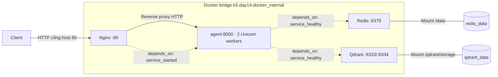

# Day 14 Lab - Mission Answers

## Part 1: Localhost vs Production

### Exercise 1.1: Anti-patterns found

1. **AP-01 — Hardcoded credentials.** `01-localhost-vs-production/develop/app.py:15-18` đặt API key mẫu và URL database có thông tin đăng nhập trực tiếp trong source. Nếu dùng credential thật, người đọc repo hoặc lịch sử Git có thể lấy được chúng. Production đọc các key từ environment tại `production/config.py:26-32`; vẫn cần quản lý secret an toàn bên ngoài code.
2. **AP-02 — Logging sensitive information.** `develop/app.py:31-38` in cả câu hỏi và biến API key. Log có thể bị thu thập hoặc chia sẻ và làm lộ thông tin nhạy cảm. `production/app.py:110-122` ghi độ dài câu hỏi và response, không ghi key hay nội dung câu hỏi trong các event này. Không suy ra mọi log production đều hợp lệ hoặc an toàn.
3. **AP-03 — Missing health/readiness endpoints.** `develop/app.py:25-39` chỉ khai báo `/` và `/ask`; `develop/app.py:42-43` cũng nêu thiếu health check. Thiếu probe chuyên dụng làm platform khó kiểm tra trạng thái process và mức sẵn sàng. `production/app.py:135-161` có `/health` và `/ready`; readiness ở đây chỉ dựa vào cờ nội bộ, chưa kiểm tra dependency ngoài.
4. **AP-04 — Hardcoded host and port.** `develop/app.py:47-53` cố định host loopback và port 8000. Service có thể không nhận kết nối từ bên ngoài môi trường chạy hoặc không nghe port platform cấp. Production đọc `HOST` và `PORT` từ environment tại `production/config.py:16-19` và dùng chúng ở `production/app.py:192-198`.
5. **AP-05 — Auto reload always enabled.** `develop/app.py:49-53` đặt `reload=True`; file watcher có thể gây restart ngoài dự kiến trong môi trường vận hành. Production chỉ bật reload khi `DEBUG=true`, mặc định false: `production/config.py:19`, `production/app.py:192-198`.
6. **AP-06 — Hardcoded application configuration.** `develop/app.py:20-22` đặt cố định `DEBUG` và `MAX_TOKENS`, gây khó thay cấu hình giữa các môi trường. Hai biến này không thấy được dùng trong request handler develop, nên không kết luận chúng đã gây lỗi runtime. Production định nghĩa cấu hình tương ứng từ environment tại `production/config.py:19-29`.

Đường dẫn `develop/` và `production/` viết tắt ở trên đều thuộc `01-localhost-vs-production/`.

### Exercise 1.2: Development runtime testing

Người dùng chạy từ `01-localhost-vs-production/develop`:

```bash
../../.venv/bin/python app.py
```

Startup thực tế: Uvicorn lắng nghe `localhost:8000`; reloader PID 11079, server PID 11097; application startup hoàn tất.

| ID | Request | Expected | Actual | Response thực tế | Kết quả |
| --- | --- | --- | --- | --- | --- |
| TC-01 | `GET /` | 200 | 200 | `{"message":"Hello! Agent is running on my machine :)"}` | PASS |
| TC-02 | `POST /ask?question=Hello` | 200 | 200 | `{"answer":"Tôi là AI agent được deploy lên cloud. Câu hỏi của bạn đã được nhận."}` | PASS |
| TC-03 | `POST /ask`, JSON `{"question":"Hello"}` | 422 | 422 | `{"detail":[{"type":"missing","loc":["query","question"],"msg":"Field required","input":null}]}` | PASS |
| TC-04 | `GET /health` | 404 | 404 | `{"detail":"Not Found"}` | PASS |
| TC-05 | `GET /ready` | 404 | 404 | `{"detail":"Not Found"}` | PASS |

Development HTTP tests: **5/5 PASS**. Người dùng đã dừng develop và xác nhận port 8000 không còn listener trước khi chạy production.

Theo `develop/app.py:30-31`, `question` là query parameter, tức nằm trên URL; JSON body là dữ liệu trong thân request và không thay thế tham số query bắt buộc này. Vì vậy TC-03 trả 422 cho input thiếu theo contract, còn 404 ở TC-04/05 cho biết các route đó không tồn tại ở develop. Cả hai bản gọi Mock LLM cục bộ; response có thể thay đổi do lựa chọn ngẫu nhiên (`develop/utils/mock_llm.py:21-32`).

### Exercise 1.3: Comparison table

Các nhận định trong bảng là phân tích **source**; kết quả thực tế được ghi riêng ở các test case bên dưới và tại Exercise 1.2.

| Feature | Develop | Production | Why Important? |
|---|---|---|---|
| Configuration | Giá trị đặt trong `develop/app.py:20-22`. | `production/config.py:14-29` đọc environment. | Cấu hình theo môi trường không cần sửa source; hai biến mẫu develop không thấy được dùng trong handler. |
| Secret management | Key và thông tin kết nối mẫu nằm trong source: `develop/app.py:15-18`. | Key đọc từ environment: `production/config.py:26-32`. | Tránh đưa credential thật vào code và lịch sử Git; đọc env không tự bảo đảm xác thực API. |
| Logging | `print` câu hỏi và key: `develop/app.py:31-38`. | Log event gồm độ dài và client IP: `production/app.py:27-32,110-122`. | Hạn chế lộ nội dung; formatter có dạng JSON nhưng không thể khẳng định mọi dòng là JSON hợp lệ. |
| Network binding | `localhost:8000` cố định: `develop/app.py:47-53`. | Host/port từ config, mặc định `0.0.0.0:8000`: `production/config.py:17-18`, `production/app.py:192-197`. | Giúp service nhận kết nối và dùng port do môi trường cấp. |
| Auto reload | Luôn bật khi chạy file: `develop/app.py:49-53`. | Theo `DEBUG`, mặc định tắt: `production/config.py:19`, `production/app.py:198`. | Tránh tự restart do thay đổi file khi vận hành. |
| Request contract | `POST /ask` nhận query, response chứa `answer`: `develop/app.py:29-39`. | `POST /ask` đọc JSON và trả `question`, `answer`, `model`: `production/app.py:102-128`. | Client cần gửi đúng định dạng; contract sai dẫn tới lỗi thay vì kết quả mong đợi. |
| Health check | Không khai báo `/health`: `develop/app.py:25-43`. | `GET /health`: `production/app.py:135-149`. | Probe giúp theo dõi process còn đáp ứng. |
| Readiness check | Không khai báo `/ready`: `develop/app.py:25-43`. | `GET /ready` dựa trên cờ lifecycle: `production/app.py:35-36,152-161`. | Giúp quyết định route traffic; cờ nội bộ chưa chứng minh dependency ngoài sẵn sàng. |
| Metrics | Không khai báo `/metrics`: `develop/app.py:25-43`. | `GET /metrics` trả JSON uptime, environment, version: `production/app.py:164-173`. | Cung cấp thông tin quan sát cơ bản; response không phải Prometheus exposition format. |
| Lifecycle management | Không có lifespan do ứng dụng khai báo: `develop/app.py:13-54`. | Có lifespan startup/shutdown và handler SIGTERM: `production/app.py:39-67,180-189`. | Cho phép chuẩn bị và dọn dẹp tài nguyên; hành vi graceful đầy đủ cần kiểm thử riêng. |

#### Production startup và HTTP evidence

Người dùng quan sát warning `OPENAI_API_KEY not set — using mock LLM`, `Started server process [12757]`, `Waiting for application startup.`, `Application startup complete.` và Uvicorn lắng nghe `http://0.0.0.0:8000`. Không quan sát thấy reloader process.

| ID | Request | Expected | Actual | Response thực tế | Kết quả |
| --- | --- | --- | --- | --- | --- |
| TC-06 | `GET /` | 200 | 200 | `{"app":"AI Agent","version":"1.0.0","environment":"development","status":"running"}` | PASS |
| TC-07 | `POST /ask`, JSON `{"question":"Hello"}` | 200 | 200 | `{"question":"Hello","answer":"Agent đang hoạt động tốt! (mock response) Hỏi thêm câu hỏi đi nhé.","model":"gpt-4o-mini"}` | PASS |
| TC-08 | `POST /ask`, JSON `{}` | 422 | 422 | `{"detail":"question field is required"}` | PASS |
| TC-09 | `GET /health` | 200 | 200 | `{"status":"ok","uptime_seconds":35.9,"version":"1.0.0","environment":"development","timestamp":"2026-11-26T07:34:35.024017+00:00"}` | PASS |
| TC-10 | `GET /ready` | 200 | 200 | `{"ready":true}` | PASS |
| TC-11 | `GET /metrics` | 200 | 200 | `{"uptime_seconds":35.9,"environment":"development","version":"1.0.0"}` | PASS |

Production HTTP tests: **6/6 PASS**.

#### Production shutdown evidence

Người dùng nhấn Ctrl+C. Log ghi `Shutting down`, `Waiting for application shutdown.`, `Application shutdown complete.` và `Finished server process [12757]`. Sau đó xuất hiện traceback gồm `asyncio.exceptions.CancelledError` và `KeyboardInterrupt`. Hai lần kiểm tra `ss -ltnp | grep ':8000'` đều không có output.

| Hạng mục | Kết quả |
| --- | --- |
| Application shutdown lifecycle | PASS |
| Server termination và giải phóng port 8000 | PASS |
| Shutdown không có exception | WARNING: có traceback sau log shutdown |
| Exit code | Chưa xác minh |
| Graceful shutdown bằng SIGTERM | Chưa kiểm thử |
| Hoàn tất request đang xử lý khi shutdown | Chưa kiểm thử |
| Nguyên nhân traceback | Chưa xác minh |

Các bằng chứng trên chưa chứng minh graceful shutdown toàn diện.

### Part 1 — Test summary

- Development: **5/5 PASS**; Production: **6/6 PASS**.
- Tổng: **11/11 HTTP tests PASS**, tương đương **100% trong phạm vi các test đã thực hiện**.

### Limitations

- Chưa cloud deployment; cả hai phiên bản sử dụng Mock LLM. Nhãn `gpt-4o-mini` trong response không chứng minh OpenAI API đã được gọi.
- Source bản production chạy với runtime environment `development`; endpoint `/ask` của Part 1 chưa xác thực API key.
- Readiness chưa kiểm tra external dependencies; metrics chưa ở Prometheus exposition format.
- Shutdown lifecycle và port release PASS; exception-free shutdown WARNING. Exit code, SIGTERM, hoàn tất request đang xử lý và nguyên nhân traceback chưa được xác minh.

## Part 2: Docker

### Exercise 2.1: Dockerfile questions

1. **Base image.** Development dùng `python:3.11` với một stage. Production dùng `python:3.11-slim` cho cả hai stage `builder` và `runtime`. [Development Dockerfile dòng 8](02-docker/develop/Dockerfile#L8), [Production Dockerfile dòng 16 và 36](02-docker/production/Dockerfile#L16-L36).
2. **Working directory.** `WORKDIR /app` đặt thư mục làm việc trong container cho các instruction tiếp theo và lệnh khởi động mặc định. Production đặt `WORKDIR /app` trong cả hai stage. [Development Dockerfile dòng 11](02-docker/develop/Dockerfile#L11), [Production Dockerfile dòng 18 và 42](02-docker/production/Dockerfile#L18-L42).
3. **Vì sao copy requirements trước source.** Development copy `requirements.txt`, chạy `pip install --no-cache-dir`, rồi mới copy `app.py` và mock LLM. Khi chỉ sửa source, Docker có thể tái sử dụng layer cài dependencies nếu các đầu vào và layer trước đó vẫn khớp. Khi requirements thay đổi, layer `COPY` tương ứng và bước cài đặt phía sau phải được tính lại. `--no-cache-dir` tắt cache của pip, còn Docker vẫn có thể lưu và tái sử dụng layer của bước `RUN`. Production cũng cài requirements ở builder trước khi copy source vào runtime. [Development Dockerfile dòng 13–24](02-docker/develop/Dockerfile#L13-L24), [Production Dockerfile dòng 26–52](02-docker/production/Dockerfile#L26-L52).
4. **CMD và ENTRYPOINT.** `ENTRYPOINT` xác định chương trình khởi động chính. Khi dùng dạng exec của cả hai instruction, `CMD` cung cấp đối số mặc định cho `ENTRYPOINT`. Nếu không có entrypoint, `CMD` cung cấp lệnh mặc định. Đối số sau tên image trong `docker run` thay thế `CMD`, còn `--entrypoint` ghi đè entrypoint. Cả hai Dockerfile đều không khai báo `ENTRYPOINT` tường minh. Development dùng `CMD ["python", "app.py"]`, production dùng `CMD` chạy Uvicorn với hai workers. [Development Dockerfile](02-docker/develop/Dockerfile#L8-L30), [Production Dockerfile](02-docker/production/Dockerfile#L16-L72).

Development dùng user mặc định kế thừa từ base image và không khai báo Docker `HEALTHCHECK`. Ứng dụng vẫn cung cấp HTTP endpoint `/health`. [Development Dockerfile dòng 8–30](02-docker/develop/Dockerfile#L8-L30), [Development app.py dòng 25–31](02-docker/develop/app.py#L25-L31).

Dấu `.` trong hai lệnh build chỉ build context ở gốc repo. Nguồn của `COPY` được tra theo context này, gồm các đường dẫn dưới `02-docker/` và `utils/mock_llm.py`. Root `.dockerignore` lọc các mục khớp quy tắc trước khi gửi context cho builder, giúp giảm dữ liệu truyền và tránh đưa các mục như virtualenv, Git metadata hoặc tệp môi trường bị loại vào build context. Cấu hình có ngoại lệ cho `.env.example`. [Development Dockerfile dòng 13–24](02-docker/develop/Dockerfile#L13-L24), [Production Dockerfile dòng 26–52](02-docker/production/Dockerfile#L26-L52), [Root .dockerignore](.dockerignore#L1-L38).

### Exercise 2.2: Build và run

Lệnh build đã chạy từ gốc repo.

```bash
docker build -f 02-docker/develop/Dockerfile -t my-agent:develop .
```

Build hoàn tất `12/12 FINISHED` trong 253.4 giây. Image ID `2a429c36234e`, platform `linux/amd64`, kích thước chính xác 1667788057 bytes. `docker images` hiển thị disk usage 1.67 GB và content size 426 MB.

```bash
docker run -d --rm \
  --name k5-day14-cp2-develop \
  -p 127.0.0.1:8000:8000 \
  my-agent:develop
```

Container ID `f5e7268fc2c3`, command `python app.py`, trạng thái `Status=running Running=true`. Log ghi server PID 1, `Application startup complete` và Uvicorn lắng nghe tại `http://0.0.0.0:8000`. Host mapping là `127.0.0.1:8000 -> 8000/tcp`.

#### TC-CP2-01 — Health trực tiếp

```bash
curl -i http://127.0.0.1:8000/health
```

Thực tế trả về **HTTP 200 OK** lúc 08:08:36 GMT ngày 2026-11-26.

```json
{"status":"ok","uptime_seconds":83.6,"container":true}
```

#### TC-CP2-02 — Agent trực tiếp

```bash
curl -i -X POST 'http://127.0.0.1:8000/ask?question=Hello'
```

Thực tế trả về **HTTP 200 OK** lúc 08:08:36 GMT ngày 2026-11-26. Bản development nhận `question` qua query string. [Development app.py dòng 20–22](02-docker/develop/app.py#L20-L22).

```json
{"answer":"Agent đang hoạt động tốt! (mock response) Hỏi thêm câu hỏi đi nhé."}
```

Access log thu trước khi dừng container.

```text
INFO: 172.17.0.1:59442 - "GET /health HTTP/1.1" 200 OK
INFO: 172.17.0.1:59456 - "POST /ask?question=Hello HTTP/1.1" 200 OK
```

**2/2 PASS.** Lệnh `docker stop k5-day14-cp2-develop` thành công. Docker tự xóa container do dùng `--rm` và giữ lại image. Sau cleanup, WSL không còn listener trên cổng 8000 và Git working tree vẫn sạch. Log được thu trước khi dừng nên bằng chứng này chỉ xác nhận container đã dừng và cổng được giải phóng.

### Exercise 2.3: Image size comparison

Lệnh build production đã chạy từ gốc repo.

```bash
docker build -f 02-docker/production/Dockerfile -t my-agent:advanced .
```

Build hoàn tất `17/17 FINISHED` trong 159.9 giây. Image ID `d236840ef7fa`. `docker images` hiển thị disk usage 240 MB và content size 57.4 MB.

| Chỉ số | Development | Production |
| --- | --- | --- |
| Base image | `python:3.11` | `python:3.11-slim` |
| Số build stages | 1 | 2 |
| Kích thước chính xác (bytes) | 1667788057 | 239815445 |
| Kích thước theo MB thập phân | 1667.79 | 239.82 |
| Disk usage hiển thị | 1.67 GB | 240 MB |
| Content size | 426 MB | 57.4 MB |
| Thời gian build | 253.4 s | 159.9 s |
| User | User mặc định của base image | `appuser` |
| Docker HEALTHCHECK | Không | Có |

Mức giảm tính từ số byte chính xác là `(1667788057 - 239815445) / 1667788057 × 100`, làm tròn thành **85.62%**. Mức giảm là hiệu ứng kết hợp của base image slim và multi-stage build. Builder cài `gcc`, `libpq-dev` và dùng `pip install --no-cache-dir --user` để cài Python packages vào `/root/.local`. Runtime bắt đầu từ base slim riêng, copy packages sang `/home/appuser/.local`, thêm source và chạy với user non-root `appuser`. Các layer cài build tools ở builder không được đưa vào image runtime. Hai thời gian build là số đo quan sát được từ từng lần chạy, chưa qua benchmark có kiểm soát. [Production Dockerfile dòng 16–62](02-docker/production/Dockerfile#L16-L62).

Cấu hình image production quan sát được.

```text
User=appuser
Cmd=["uvicorn","main:app","--host","0.0.0.0","--port","8000","--workers","2"]
```

Docker `HEALTHCHECK` gọi `http://localhost:8000/health` mỗi 30 giây, với timeout 10 giây, start period 5 giây và 3 retries. Healthcheck cập nhật trạng thái sức khỏe container. Riêng trạng thái `unhealthy` không kích hoạt tự khởi động lại container. [Production Dockerfile dòng 67–72](02-docker/production/Dockerfile#L67-L72).

### Exercise 2.4: Docker Compose stack



Các mũi tên nét đứt biểu diễn thứ tự khởi động theo cấu hình. Agent chờ healthcheck của Redis và Qdrant. Nginx dùng cú pháp ngắn của `depends_on` và chờ Agent khởi động. Compose đặt `REDIS_URL` và `QDRANT_URL`, nhưng handler `/ask` gọi mock LLM và `/health` trả trạng thái ứng dụng. Luồng HTTP được xác minh đi từ Client qua Nginx đến Agent. Chưa có bằng chứng Agent đọc hoặc ghi dữ liệu qua Redis hay Qdrant. Qdrant dùng cổng 6333 cho HTTP và 6334 cho gRPC. Healthcheck trong Compose kiểm tra TCP 6333. [Compose dòng 22–84 và 89–114](02-docker/production/docker-compose.yml#L22-L114), [Nginx dòng 14–29 và 42–63](02-docker/production/nginx/nginx.conf#L14-L63), [Production main.py dòng 57–81](02-docker/production/main.py#L57-L81).

#### Xác thực cấu hình

Trong `02-docker/production`, sinh viên tạo `.env.local` rỗng (0 bytes) theo khai báo `env_file`. Quy tắc Git ignore áp dụng là `.gitignore:5:.env.*`. Project name là `k5-day14-docker`. [Compose dòng 34–35](02-docker/production/docker-compose.yml#L34-L35), [.gitignore dòng 5](.gitignore#L5).

```bash
docker compose -p k5-day14-docker config --quiet
```

Exit code 0. Compose cảnh báo thuộc tính `version` đã lỗi thời và bị bỏ qua. Cảnh báo không cản trở bước xác thực và cấu hình được giữ nguyên.

#### Khởi động và trạng thái service

```bash
docker compose -p k5-day14-docker up -d --build
```

Redis, Qdrant và Nginx được pull thành công. Agent build đạt `19/19 FINISHED` trong 3.3 giây và tái sử dụng các layer từ cache. Compose báo image Agent được build trong 3.7 giây. Image ID của Agent là `49416e5ad6d8`. Network `k5-day14-docker_internal` và hai named volumes được tạo. Cả bốn container đều khởi động thành công.

| Service | Image | Trạng thái quan sát |
| --- | --- | --- |
| Agent | `k5-day14-docker-agent` | Healthy |
| Redis | `redis:7-alpine` | Healthy |
| Qdrant | `qdrant/qdrant:v1.9.0` | Healthy |
| Nginx | `nginx:alpine` | Running |

**4/4 service running, 3/3 healthcheck đã cấu hình báo Healthy.** Compose đặt start period của Agent là 10 giây, ghi đè mức 5 giây của image. Log Agent ghi Uvicorn parent PID 1 và worker PID 8, 9 trong cùng một container. Chỉ Nginx publish cổng 80 và 443 ra host. Nginx cấu hình `listen 80` và các test dưới đây xác minh HTTP. [Compose dòng 41–47 và 89–100](02-docker/production/docker-compose.yml#L41-L100), [Nginx dòng 27–29](02-docker/production/nginx/nginx.conf#L27-L29).

#### Mức sử dụng tài nguyên

| Service | CPU | Bộ nhớ |
| --- | ---: | ---: |
| Agent | 1.25% | 100.6 MiB |
| Redis | 1.66% | 8.312 MiB |
| Qdrant | 0.27% | 172.5 MiB |
| Nginx | 0.00% | 2.746 MiB |

Tổng bộ nhớ quan sát được khoảng **284.16 MiB**. Đây là snapshot tại thời điểm stack gần như nhàn rỗi.

#### TC-CP2-03 — Health qua Nginx

```bash
curl -i --max-time 15 http://127.0.0.1/health
```

Thực tế trả về **HTTP 200 OK**, `Server: nginx`, lúc 08:22:11 GMT ngày 2026-11-26.

```json
{"status":"ok","uptime_seconds":154.9,"version":"2.0.0","timestamp":"2026-11-26T08:22:11.320915"}
```

#### TC-CP2-04 — Agent qua Nginx

```bash
curl -i --max-time 15 \
  -X POST http://127.0.0.1/ask \
  -H "Content-Type: application/json" \
  -d '{"question":"Explain microservices"}'
```

Thực tế trả về **HTTP 200 OK**, `Server: nginx`, lúc 08:22:16 GMT ngày 2026-11-26.

```json
{"answer":"Đây là câu trả lời từ AI agent (mock). Trong production, đây sẽ là response từ OpenAI/Anthropic."}
```

Cả hai response đều chứa các header sau.

```http
X-Frame-Options: DENY
X-Content-Type-Options: nosniff
X-XSS-Protection: 1; mode=block
Connection: keep-alive
```

`X-XSS-Protection` là cơ chế lọc XSS legacy. `Connection: keep-alive` điều khiển việc duy trì kết nối HTTP và không phải security header. [Nginx dòng 31–37](02-docker/production/nginx/nginx.conf#L31-L37).

#### Bằng chứng reverse proxy

Nginx access log ghi nhận request từ client.

```text
172.20.0.1 - - [26/Nov/2026:08:22:16 +0000] "POST /ask HTTP/1.1" 200 126 "-" "curl/8.5.0"
```

Agent access log ghi cả hai request đến upstream.

```text
172.20.0.5:42410 - "GET /health HTTP/1.1" 200 OK
172.20.0.5:42410 - "POST /ask HTTP/1.1" 200 OK
```

Client nhận `Server: nginx` cùng payload đúng với hai handler của Agent. Hai dòng access log của Agent khớp method, path và status của các request. Riêng `POST /ask` có thêm dòng tương ứng ở Nginx. Nginx tắt access log ở location `/health`, nên bằng chứng cho request này là HTTP response, cấu hình proxy và log upstream. Kết quả **2/2 test HTTP qua Nginx PASS**. [Nginx dòng 42–63](02-docker/production/nginx/nginx.conf#L42-L63), [Production main.py dòng 57–74](02-docker/production/main.py#L57-L74).

#### Cleanup

```bash
docker compose -p k5-day14-docker down
```

Exit code 0. Bốn container và network `k5-day14-docker_internal` đã được xóa, không còn container đang chạy. Hai image `my-agent:develop` và `my-agent:advanced` vẫn còn. Hai named volumes `k5-day14-docker_qdrant_data` và `k5-day14-docker_redis_data` vẫn tồn tại. Việc kiểm tra chỉ xác nhận hai volume được giữ lại, chưa kiểm thử persistence bằng cách ghi rồi đọc dữ liệu. WSL không còn TCP listener trên cổng 80, 443 hoặc 8000. Git working tree sạch tại thời điểm cleanup và HEAD vẫn là `820b15d`.

### Part 2 — Tổng hợp kiểm thử

| ID | Đường gọi | Mong đợi | Thực tế (GMT, 2026-11-26) | Kết quả |
| --- | --- | --- | --- | --- |
| TC-CP2-01 | Trực tiếp `GET /health` | HTTP 200, `status=ok` | HTTP 200, `status=ok`, 08:08:36 | PASS |
| TC-CP2-02 | Trực tiếp `POST /ask?question=Hello` | HTTP 200, mock answer | HTTP 200, mock answer, 08:08:36 | PASS |
| TC-CP2-03 | Qua Nginx `GET /health` | HTTP 200, `status=ok` | HTTP 200, `status=ok`, 08:22:11 | PASS |
| TC-CP2-04 | Qua Nginx `POST /ask`, body JSON | HTTP 200, mock answer | HTTP 200, mock answer, 08:22:16 | PASS |

**Tổng cộng 4/4 HTTP tests PASS.**

### Part 2 — Giới hạn kiểm thử

- Chỉ dùng mock LLM. Chưa có inference qua dịch vụ LLM bên ngoài.
- Chưa xác minh HTTPS/TLS hoặc thử thực thi rate limit của Nginx.
- Chưa chứng minh thao tác dữ liệu qua Agent với Redis hoặc Qdrant.
- Chưa load test, so sánh throughput hoặc kiểm thử load balancing với nhiều replica.
- Chưa kiểm thử graceful shutdown toàn diện hoặc kiểm tra cổng phía Windows sau cleanup.
- Request log quan sát được có định dạng giống JSON nhưng lỗi escaping.

```text
{"time":"2026-11-26 08:22:15,925","level":"INFO","msg":"{"event": "request", "q_len": 21}"}
```

Formatter chèn trực tiếp chuỗi do `json.dumps` tạo vào giá trị `msg` đã có dấu ngoặc kép bao quanh. Dấu ngoặc kép trước `event` kết thúc chuỗi `msg` sớm vì không được escape, khiến parser không thể đọc phần còn lại như một JSON object hợp lệ. [Production main.py dòng 16–20 và 57–64](02-docker/production/main.py#L16-L64).

## Part 4: API Security

### Exercise 4.1: API Key authentication

- **Key được kiểm tra ở đâu?** `POST /ask` gọi dependency `verify_api_key`, đọc header `X-API-Key` qua `APIKeyHeader` và so sánh với `AGENT_API_KEY` đã đọc khi nạp module. Sau khi xác thực, handler đọc JSON và trả HTTP 422 nếu thiếu `question`. [Develop app.py dòng 35–54 và 67–80](04-api-gateway/develop/app.py#L35-L80).
- **Điều gì xảy ra nếu sai key?** Key sai trả HTTP 403. Header thiếu hoặc rỗng trả HTTP 401. [Develop app.py dòng 39–54](04-api-gateway/develop/app.py#L39-L54).
- **Rotate key thế nào?** Đặt giá trị mới cho `AGENT_API_KEY`, khởi động lại tiến trình để nạp cấu hình mới và cập nhật key phía client. Sau restart, key cũ bị từ chối và key mới dùng được. Hai key demo tạm thời đã được che. [Develop app.py dòng 35–54](04-api-gateway/develop/app.py#L35-L54).

Sinh viên chạy Uvicorn trực tiếp tại `127.0.0.1:8000` với key từ môi trường để tránh in key qua banner của entry point `python app.py`. [Develop app.py dòng 89–93](04-api-gateway/develop/app.py#L89-L93).

| ID | Trường hợp | HTTP thực tế | Kết quả |
| --- | --- | --- | --- |
| KEY-01 | Thiếu API key | 401 | PASS |
| KEY-02 | API key sai | 403 | PASS |
| KEY-03 | API key hợp lệ | 200 | PASS |
| KEY-04 | API key rỗng | 401 | PASS |
| KEY-05 | Key hợp lệ, thiếu `question` | 422 | PASS |
| Rotation | Key cũ sau restart | 403 | PASS |
| Rotation | Key mới sau restart | 200 | PASS |

**7/7 PASS.** Trích mã HTTP đã xác minh từ kết quả `curl -i` (KEY-01 và KEY-03).

```text
KEY-01  401 Unauthorized
KEY-03  200 OK
```

Shutdown hoàn tất ở cấp ứng dụng. Sau đó terminal hiện `Aborted!` và cổng đã được giải phóng. Exit code và nguyên nhân của thông báo chưa được xác định.

### Exercise 4.2: JWT authentication (Advanced)

Đăng nhập qua `POST /auth/token` theo hướng dẫn dành cho lớp K5. Endpoint kiểm tra thông tin đăng nhập và trả access token kiểu bearer. Token ký bằng HS256, có các claim `sub`, `role`, `iat`, `exp` và hết hạn sau 60 phút. Hai role được cấu hình là `user` và `admin`. Phiên kiểm thử tạo ngẫu nhiên `JWT_SECRET` khi khởi động server. Giá trị token, phần token trong `hint`, secret và thông tin đăng nhập đều được che. [README dòng 23–26](README.md#L23-L26), [Production app.py dòng 96–118](04-api-gateway/production/app.py#L96-L118), [auth.py dòng 22–43 và 70–75](04-api-gateway/production/auth.py#L22-L75).

Client gửi `Authorization: Bearer <redacted>` với `POST /ask`. Dependency `verify_token` giải mã token bằng cùng secret và thuật toán, rồi lấy định danh cùng role cho handler. Theo source, token hết hạn có nhánh trả 401 riêng. Trường hợp hết hạn chưa được kiểm thử runtime. [Production app.py dòng 125–138](04-api-gateway/production/app.py#L125-L138), [auth.py dòng 46–67](04-api-gateway/production/auth.py#L46-L67).

| ID | Trường hợp | HTTP thực tế | Kết quả |
| --- | --- | --- | --- |
| JWT-01 | Đăng nhập hợp lệ | 200 | PASS |
| JWT-02 | Thông tin đăng nhập sai | 401 | PASS |
| JWT-03 | Thiếu bearer token khi gọi `/ask` | 401 | PASS |
| JWT-04 | Bearer token sai khi gọi `/ask` | 403 | PASS |
| JWT-05 | Bearer token hợp lệ khi gọi `/ask` | 200 | PASS |

**5/5 PASS.** Token nhận được qua đăng nhập với role `user` được dùng cho vòng gọi ở Exercise 4.3.

#### Startup và shutdown của production

```text
Security layer initialized.
Application startup complete.
Uvicorn running on http://127.0.0.1:8000.
```

```text
Shutting down.
Waiting for application shutdown.
Shutdown.
Application shutdown complete.
Finished server process [42752].
```

Không quan sát thấy traceback trong log shutdown này. Chưa kiểm thử xử lý SIGTERM hoặc xác minh các request đang xử lý có hoàn tất khi shutdown. [Production app.py dòng 49–53](04-api-gateway/production/app.py#L49-L53).

### Exercise 4.3: Rate limiting

- **Thuật toán.** Docstring gọi là *Sliding Window Counter*. Mã thực tế dùng *Sliding Window Log*: mỗi user có một `deque` lưu timestamp riêng của từng request được limiter chấp nhận. Mỗi lượt kiểm tra bỏ timestamp ngoài cửa sổ, đếm số phần tử còn lại, trả 429 nếu đã đủ hạn mức hoặc thêm timestamp mới nếu còn chỗ. Trạng thái nằm trong bộ nhớ của từng tiến trình. [rate_limiter.py dòng 1–10 và 17–71](04-api-gateway/production/rate_limiter.py#L1-L71).
- **Hạn mức và admin.** Role `user` có 10 request mỗi 60 giây. Role `admin` đi qua limiter riêng với 100 request mỗi 60 giây và vẫn chịu giới hạn. Chưa kiểm thử runtime với admin hoặc kiểm thử việc gọi lại thành công sau khi hết thời gian chờ. [rate_limiter.py dòng 85–87](04-api-gateway/production/rate_limiter.py#L85-L87), [Production app.py dòng 137–145](04-api-gateway/production/app.py#L137-L145).

#### RATE-01 — 20 request trong 2 giây

| Lượt gọi | HTTP thực tế | Số lượng |
| --- | --- | --- |
| 1–10 | 200 OK | 10 |
| 11–20 | 429 Too Many Requests | 10 |

**RATE-01 PASS.** Trích mã HTTP và header đã xác minh từ response từ chối.

```http
429 Too Many Requests
X-RateLimit-Limit: 10
X-RateLimit-Remaining: 0
Retry-After: 59
```

```json
{"detail":{"error":"Rate limit exceeded","limit":10,"window_seconds":60,"retry_after_seconds":59}}
```

Server ghi usage cho 10 request được chấp nhận trong RATE-01 và request JWT-05 thành công trước đó. Log không có bản ghi usage tương ứng với 10 request bị từ chối. Handler kiểm tra rate limit trước daily budget, mock LLM và ghi usage. Rate limit kiểm soát tần suất gọi, còn cost guard kiểm soát tiền vì chi phí mỗi lượt có thể khác nhau theo số token. Trong response `/ask`, trường `usage.budget_remaining_usd` thực tế chứa chi phí tích lũy từ `usage.total_cost_usd`. Endpoint `/me/usage` tính phần còn lại bằng ngân sách trừ chi phí đã dùng. [Production app.py dòng 140–168](04-api-gateway/production/app.py#L140-L168), [cost_guard.py dòng 32–36](04-api-gateway/production/cost_guard.py#L32-L36), [cost_guard.py dòng 93–124](04-api-gateway/production/cost_guard.py#L93-L124).

### Exercise 4.4: Monthly Cost Guard

```python
def check_budget(user_id: str, estimated_cost: float) -> bool:
```

Mỗi user có ngân sách **10 USD/tháng**. Redis lưu tổng chi phí ước tính theo key `budget:{user_id}:{YYYY-MM}`. Tháng lấy theo giờ local của tiến trình. Đầu tháng mới dùng key riêng với số dư chi tiêu ban đầu bằng 0. Mỗi lần chấp nhận, hàm ghi chi phí ước tính ngay, làm mới TTL thành 32 ngày và trả `True`. Tổng đúng 10 USD được chấp nhận. Tổng vượt 10 USD trả `False`, giữ nguyên chi phí và thời điểm hết hạn, đồng thời tránh tạo key mới nếu đó là lần tính phí đầu tiên. Client đọc `REDIS_URL`, mặc định `redis://localhost:6379/0`. Phép tính dùng `Decimal`, chuyển đầu vào qua chuỗi trước khi cộng. Chi phí âm hoặc không hữu hạn gây `ValueError`. [monthly_cost_guard.py dòng 11–45](04-api-gateway/production/monthly_cost_guard.py#L11-L45).

Lời giải tham khảo tách `GET`, kiểm tra giới hạn, `INCRBYFLOAT` và `EXPIRE`. Hai request có thể cùng đọc 7 USD và cùng duyệt khoản 3 USD, khiến cả hai phép tăng thành công và tổng lên 13 USD. `INCRBYFLOAT` nguyên tử riêng lẻ vẫn để hở khoảng giữa lúc đọc và lúc ghi. Bản triển khai dùng `WATCH` trước khi đọc, rồi `MULTI/EXEC` để ghi tổng mới cùng TTL bằng một lệnh `SET`. Khi key thay đổi trong lúc giao dịch, request xung đột phải đọc và kiểm tra lại trước khi có thể ghi. Giao dịch `WATCH/MULTI`, số học `Decimal` và test hồi quy đồng thời là các quyết định kỹ thuật bổ sung ngoài yêu cầu bắt buộc của lab. [Lời giải Exercise 4.4 trong CODE_LAB.md dòng 429–448](CODE_LAB.md#L429-L448), [monthly_cost_guard.py dòng 20–50](04-api-gateway/production/monthly_cost_guard.py#L20-L50), [test_monthly_cost_guard.py dòng 105–118](04-api-gateway/production/test_monthly_cost_guard.py#L105-L118).

#### Tệp triển khai

- `04-api-gateway/production/monthly_cost_guard.py` triển khai hàm kiểm tra và ghi chi phí. [Mã nguồn dòng 20–50](04-api-gateway/production/monthly_cost_guard.py#L20-L50).
- `04-api-gateway/production/test_monthly_cost_guard.py` chứa 10 integration test dùng Redis thật. [Bộ test dòng 16–118](04-api-gateway/production/test_monthly_cost_guard.py#L16-L118).
- `04-api-gateway/production/requirements.txt` thêm `redis==5.1.0`. [requirements.txt dòng 5](04-api-gateway/production/requirements.txt#L5).

#### Môi trường và kết quả kiểm thử

Sinh viên chạy trên WSL với Python 3.12.3, Redis server 7.4.12 và Redis Python client 5.1.0. Redis chạy từ Docker image `redis:7-alpine` tại `redis://127.0.0.1:16379/0`. `pip check` trả `No broken requirements found.` và PING từ Python tới Redis **PASS**.

Lệnh tái lập từ thư mục gốc của repo, với Redis và môi trường Python như trên.

```bash
REDIS_URL=redis://127.0.0.1:16379/0 \
  "$HOME/.venvs/day14-cp3-production/bin/python" \
  -m unittest discover \
  -s 04-api-gateway/production \
  -p 'test_monthly_cost_guard.py' -v
```

| ID | Kiểm tra | Kết quả |
| --- | --- | --- |
| COST-01 | Ghi khoản phí đầu tiên | PASS |
| COST-02 | Cộng dồn chi phí | PASS |
| COST-03 | Chấp nhận tổng đúng 10 USD | PASS |
| COST-04 | Từ chối vượt ngân sách, giữ nguyên chi phí | PASS |
| COST-05 | Từ chối khoản đầu tiên, không tạo key | PASS |
| COST-06 | Ngân sách độc lập giữa các user | PASS |
| COST-07 | Chuyển tháng bằng giá trị tháng giả lập, dùng key mới | PASS |
| COST-08 | Tạo TTL, giữ thời điểm hết hạn khi từ chối, làm mới TTL khi chấp nhận | PASS |
| COST-09 | Đọc lại chi phí bằng client mới sau khi đóng client ghi | PASS |
| COST-10 | Hai luồng cạnh tranh cho khoản còn lại, chỉ một khoản được chấp nhận | PASS |

```text
Ran 10 tests in 0.075s

OK
Integration test exit code: 0
```

Redis có 0 key trước bộ test và 0 key sau bộ test. Redis PING sau test trả `PONG`. [Thiết lập và dọn key của bộ test, dòng 16–32](04-api-gateway/production/test_monthly_cost_guard.py#L16-L32).

#### Giới hạn và phạm vi

- Monthly Cost Guard là triển khai độc lập cho Exercise 4.4, chưa tích hợp vào `/ask`. Daily `CostGuard` hiện có giữ nguyên. [Production app.py dòng 140–153](04-api-gateway/production/app.py#L140-L153), [cost_guard.py dòng 39–51 và 127–128](04-api-gateway/production/cost_guard.py#L39-L128).
- Đã kiểm tra dữ liệu tồn tại khi đổi kết nối client. Chưa kiểm tra độ bền dữ liệu khi khởi động lại Redis server. [COST-09 dòng 97–103](04-api-gateway/production/test_monthly_cost_guard.py#L97-L103).
- Bộ 10 test chưa có ca runtime riêng cho chi phí âm và không hữu hạn. COST-10 là test hồi quy với hai luồng, chưa phải stress test. Thời gian chạy 0.075 giây của bộ test không đo latency của API. [Kiểm tra đầu vào, dòng 20–24](04-api-gateway/production/monthly_cost_guard.py#L20-L24), [COST-10 dòng 105–118](04-api-gateway/production/test_monthly_cost_guard.py#L105-L118).
- Chi phí ước tính được ghi ngay khi chấp nhận. Đối soát với chi phí thực tế và idempotency nằm ngoài phạm vi exercise. Mọi phản hồi LLM và chi phí token trong các lượt kiểm thử đều là giá trị mock. [monthly_cost_guard.py dòng 38–45](04-api-gateway/production/monthly_cost_guard.py#L38-L45), [Production app.py dòng 147–160](04-api-gateway/production/app.py#L147-L160).

### Part 4 — Cleanup

`docker stop k5-day14-cp3-redis` trả exit code 0 và container được xóa tự động. Không còn container Docker đang chạy. Các cổng 8000, 6379 và 16379 đều trống trong WSL. Image `redis:7-alpine` vẫn còn với ID `7f7d30b7fdd0`. Không chủ động xóa volume nào đã có của lab. Lần chạy `git diff --check` trong đợt cleanup trả exit code 0.


## Part 5: Scaling & Reliability

### Exercise 5.1: Health checks — PASS

Chạy app develop bằng Python 3.12.3 trong WSL với FastAPI 0.115.0, Uvicorn 0.30.0 và psutil 6.0.0. Hai probe sau startup đều trả **HTTP 200**:

| Endpoint | Response thực tế |
| --- | --- |
| GET /health | `{"status":"ok","uptime_seconds":1.0,"version":"1.0.0","environment":"development","timestamp":"2026-11-26T09:37:49.554534+00:00","checks":{"memory":{"status":"ok","used_percent":35.3}}}` |
| GET /ready | `{"ready":true,"in_flight_requests":1}` |

Liveness cho biết tiến trình còn phục vụ được probe. Readiness cho biết app đã sẵn sàng nhận công việc. App develop bật cờ sau bước khởi tạo mô phỏng và dùng cờ để trả 200 hoặc 503. Middleware đếm cả request probe đang chạy. Nhánh 503 của develop được đối chiếu từ source, chưa kiểm thử qua HTTP. [Health](05-scaling-reliability/develop/app.py#L104) · [Readiness](05-scaling-reliability/develop/app.py#L147) · [Middleware](05-scaling-reliability/develop/app.py#L72)

### Exercise 5.2: Graceful shutdown — PASS một request, FAIL hai request theo README

Dùng query parameter cho POST /ask và gửi SIGTERM sau 0,5 giây. Ca hai request theo README ghi nhận một HTTP 200 với đầy đủ JSON answer sau 3,068 giây. Request còn lại không nhận mã HTTP và curl báo lỗi 56, `Recv failure: Connection reset by peer`, sau 3,067 giây. `kill` và `wait` của server đều trả 0. Vì vậy chỉ một trong hai request hoàn thành.

Ca một request theo CODE_LAB trả HTTP 200 sau 3,045 giây với body `{"answer":"Tôi là AI agent được deploy lên cloud. Câu hỏi của bạn đã được nhận."}`. `kill`, curl và `wait` của server đều trả 0. Log quan sát được theo thứ tự `Shutting down` → `POST /ask?question=Long%20task HTTP/1.1" 200 OK` → `Graceful shutdown initiated...` → `Shutdown complete` → `Finished server process [62898]`. Cổng 8000 hết listener sau cả hai ca.

Handler async gọi mock đồng bộ chặn event loop. Kết quả ca hai request không đủ để kết luận cả hai request đã vào handler trước SIGTERM. Giữ nguyên app mẫu. Không có kết quả HTTP 503 trong lúc shutdown. [Quy trình README](05-scaling-reliability/README.md#L104) · [Handler](05-scaling-reliability/develop/app.py#L93) · [Mock](05-scaling-reliability/develop/utils/mock_llm.py#L21) · [SIGTERM và Uvicorn](05-scaling-reliability/develop/app.py#L175)

### Exercise 5.3: Stateless design — PASS

Nếu giữ hội thoại trong RAM, mỗi replica chỉ thấy dữ liệu do chính nó lưu. App develop chỉ giữ cờ readiness và bộ đếm request trong process, không lưu hội thoại. App production ở chế độ Redis đọc và ghi JSON theo khóa session dùng chung bằng GET và SETEX, TTL một giờ kể từ lần ghi gần nhất và tối đa 20 message. Replica khác có thể đọc cùng khóa bằng session ID. Nếu Redis ping thất bại khi import, replica dùng dictionary trong RAM cho đến khi process được khởi động lại. Mock chỉ dùng câu hỏi hiện tại để sinh câu trả lời. [Develop](05-scaling-reliability/develop/app.py#L36) · [Redis và fallback](05-scaling-reliability/production/app.py#L34) · [Lưu session](05-scaling-reliability/production/app.py#L59) · [Chat](05-scaling-reliability/production/app.py#L128)

Log startup của cả ba replica ghi `Storage: Redis`. Cả mười response ở Exercise 5.4 ghi `storage: "redis"`, và Exercise 5.5 xác nhận đọc cùng session qua nhiều replica. Không thử khởi động app khi Redis mất kết nối.

### Exercise 5.4: Nginx load balancing — PASS

Chạy `docker compose -p k5-day14-scaling config --quiet` thành công sau khi tạo `.env.local` trống. Sau lệnh `docker compose -p k5-day14-scaling up -d --build --scale agent=3`, cả ba agent và Redis đều healthy, Nginx chạy với cổng host 8080. `redis-cli ping` trả `PONG`. Compose báo trường `version` đã lỗi thời và bỏ qua trường này.

Qua Nginx, `GET /health` trả HTTP 200 với `status: ok`, `storage: redis` và `redis_connected: true`. `GET /ready` trả HTTP 200 với `ready: true`. Cả **10/10 POST /chat** trả HTTP 200. Kết quả `served_by`, header `X-Served-By` và access log của từng agent cùng cho thấy phân bổ sau:

| Replica | Instance | Upstream | Số request |
| --- | --- | --- | ---: |
| agent-1 | instance-f0a70b | 172.20.0.3:8000 | 4 |
| agent-2 | instance-3f190a | 172.20.0.4:8000 | 3 |
| agent-3 | instance-a5ae15 | 172.20.0.5:8000 | 3 |

Thứ tự replica là 1, 3, 2, 1, 3, 2, 1, 3, 2, 1. Cấu hình Nginx chuyển request vào upstream `agent:8000` và ghi địa chỉ upstream vào header. Kết quả khi dừng một replica nằm ở Exercise 5.5. [Compose](05-scaling-reliability/production/docker-compose.yml#L18) · [Nginx](05-scaling-reliability/production/nginx.conf#L7) · [K5](README.md#L27)

### Exercise 5.5: Stateless test — PASS, failover có gián đoạn

`python test_stateless.py` hoàn thành năm request trong session `d5124be4-c9d6-4f0f-9930-b152c5376b37`. Các instance lần lượt là `instance-a5ae15`, `instance-3f190a`, `instance-f0a70b`, `instance-a5ae15`, `instance-3f190a`. Script in `Total messages: 10`. Đọc lại JSON từ endpoint history xác nhận năm cặp user/assistant xen kẽ và năm câu hỏi theo đúng thứ tự: Docker, containers, Kubernetes, load balancing, Redis. Cả năm câu trả lời đều có nội dung. Kết quả xác nhận hội thoại được lưu chung qua các replica ở chế độ Redis. [Script](05-scaling-reliability/production/test_stateless.py#L41) · [History endpoint](05-scaling-reliability/production/app.py#L160)

Để kiểm tra tình huống trong CODE_LAB và instructor guide, dừng riêng `k5-day14-scaling-agent-1`. Container thoát mã 0, hai agent còn lại vẫn healthy. POST tiếp vào cùng session nhận **HTTP 200** từ `instance-3f190a` với `storage: "redis"`. Lần GET history đầu tiên sau POST hết thời gian chờ của client sau 10 giây. Log Nginx ghi 499. Lần đọc lại trả **HTTP 200** qua `172.20.0.5:8000` và xác nhận **12 message**, 10 message cũ giữ nguyên và cặp user/assistant mới được thêm cuối. Ca này xác nhận tiếp tục được session sau khi dừng một agent, có gián đoạn ở một lần đọc. Không thử dừng Redis hoặc restart toàn stack. [CODE_LAB](CODE_LAB.md#L595) · [Instructor verification](INSTRUCTOR_GUIDE.md#L184)

### Part 5 — Cleanup

`docker compose -p k5-day14-scaling down` trả 0 và xóa các container cùng network CP4. `ps -a` của project không còn container, và không còn listener trên 8000 hoặc 8080 trong WSL. Không xóa image, volume hoặc tài nguyên lab khác. Image `k5-day14-scaling-agent:latest` vẫn còn với ID `fce7c6d4c328`. Đã xóa `.env.local` trống do CP4 tạo. Không sửa source hoặc script chấm.

## AI log

- **Đã hỏi:** hỗ trợ phân tích yêu cầu, thiết kế checkpoint và test cases, review kết quả và bổ sung báo cáo Part 1 theo bằng chứng có sẵn.
- **Đã nhận:** ChatGPT hỗ trợ phân tích yêu cầu, thiết kế checkpoint và test cases, review kết quả; Codex phân tích source code và hỗ trợ viết báo cáo.
- **Tự thực hiện và kiểm tra:** người dùng trực tiếp chạy server, curl, kiểm tra shutdown, port và Git status, rồi cung cấp các kết quả runtime. Không khẳng định người dùng đã xác minh độc lập mọi nhận định phân tích source trong báo cáo này.
- **Revision:** review lần đầu phát hiện `MISSION_ANSWERS.md` thiếu Exercise 1.1–1.3 và Development evidence; Codex được yêu cầu bổ sung dựa trên bằng chứng thực tế. Người dùng cần review nội dung revision này.

### Part 2 — AI usage log

- **Đã hỏi và nhận hỗ trợ.** ChatGPT hỗ trợ lập kế hoạch checkpoint, chuẩn bị lệnh, diễn giải kết quả kiểm thử và xác định tiêu chí nghiệm thu. Codex đối chiếu source ở chế độ chỉ đọc và hỗ trợ viết báo cáo từ bằng chứng CP2 đã cung cấp.
- **Sinh viên tự thực hiện và kiểm tra.** Sinh viên trực tiếp chạy các lệnh Docker và curl, kiểm tra log, trạng thái container và cleanup. Sinh viên đối chiếu mã HTTP và payload với kết quả mong đợi, kiểm tra log Nginx và Agent để xác nhận đường đi request, rồi đối chiếu trạng thái service, cổng và tài nguyên Docker còn lại với kết quả cleanup dự kiến.
- **Các điểm được làm rõ khi viết báo cáo.** Tính mức giảm từ số byte chính xác và ghi disk usage, content size trên các dòng riêng trong bảng. Phân biệt cache của pip với Docker layer cache và trạng thái `unhealthy` với hành vi tự restart. Đối chiếu `depends_on` với handler để giới hạn kết luận về luồng dữ liệu. Kiểm tra formatter và dòng log thực tế để xác định lỗi escape dấu ngoặc kép trong `msg`.

### Part 4 — AI usage log

- **Đã hỏi.** Nhờ AI đọc yêu cầu CP3 và source gateway, giải thích luồng API key, JWT, thuật toán rate limit, phân tích race condition trong lời giải Redis và hỗ trợ lập kế hoạch triển khai, kiểm thử Monthly Cost Guard. Sau khi có kết quả runtime, nhờ Codex viết Part 4 và đối chiếu từng kết luận với source và bằng chứng đã cung cấp.
- **Đã nhận hỗ trợ.** AI hỗ trợ phân tích source và triển khai Monthly Cost Guard, đề xuất giao dịch Redis `WATCH/MULTI`, phép tính `Decimal` và các ca integration test, gồm ca hồi quy đồng thời. Codex bổ sung dẫn chiếu dòng mã và ghi lại kết quả đã xác minh.
- **Sinh viên tự thực hiện và kiểm tra.** Sinh viên review và duyệt kế hoạch triển khai, trực tiếp chạy kiểm thử trên WSL, xác minh mã HTTP, kết quả xoay key, response và header của rate limit, log server, kết quả integration test Redis và trạng thái cleanup. Các số đo và kết quả trong Part 4 lấy từ đợt chạy đó.
- **Các điểm chỉnh khi review.** Gọi thuật toán theo cơ chế lưu timestamp thực tế (*Sliding Window Log*), ghi rõ admin vẫn có hạn mức, và giải thích giá trị thực của `budget_remaining_usd`. Phân biệt kiểm thử đổi client với restart Redis, ghi rõ phạm vi của ca đồng thời và các ca runtime còn thiếu. Ghi nhận riêng thông báo `Aborted!` ở bản develop và log shutdown của production. Che key, token, secret và thông tin đăng nhập trong phần bằng chứng.

### Part 5 — AI usage log

- **Đã hỏi.** Nhờ Codex rà soát yêu cầu K5 và source CP4, sau đó chạy Exercise 5.1–5.5, dọn tài nguyên và ghi kết quả.
- **Đã nhận hỗ trợ.** Codex chạy lệnh trong môi trường WSL, đối chiếu output và log, kiểm tra thứ tự lịch sử trước và sau khi dừng replica và ghi cả lỗi reset lẫn timeout.
- **Sinh viên tự thực hiện và kiểm tra.** Sinh viên yêu cầu hai giai đoạn rà soát và thực thi. Các phép thử và việc đối chiếu trong mục Part 5 do Codex thực hiện. Chưa có xác nhận sinh viên chạy lại hoặc review độc lập. Kết quả ghi theo dữ liệu thực tế, và không sửa file app hay script chấm.
