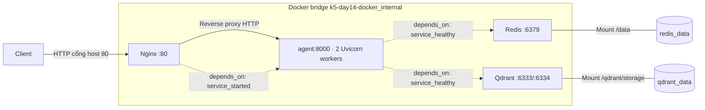
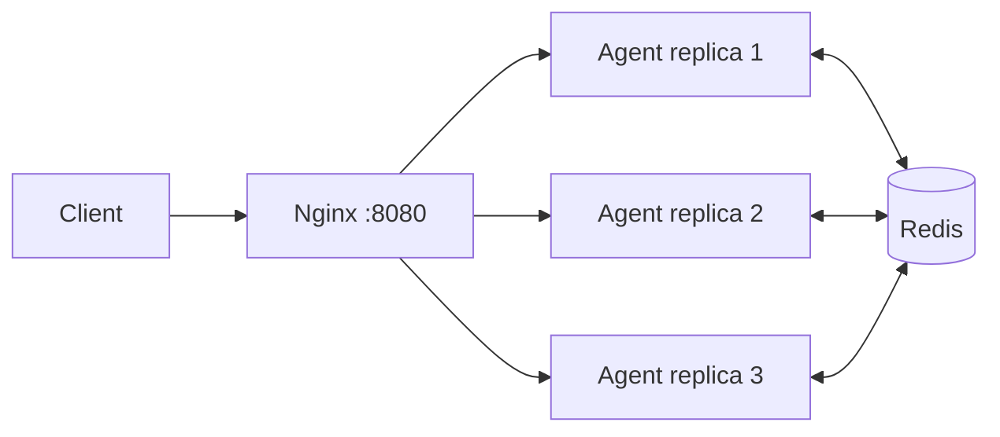

# Day 14 Lab - Mission Answers

## Part 1: Localhost vs Production

### Exercise 1.1: Anti-patterns found

Qua phân tích mã nguồn của phiên bản develop, xác định được 6 anti-pattern ảnh hưởng đến khả năng triển khai ứng dụng trong môi trường production.

1. **AP-01 — Hardcoded credentials**

   API key mẫu và URL database chứa thông tin đăng nhập được khai báo trực tiếp trong mã nguồn (`develop/app.py:15-18`). Nếu sử dụng credential thật, thông tin này có thể bị lộ khi chia sẻ repository hoặc thông qua lịch sử Git.

   Phiên bản production khắc phục bằng cách đọc các thông tin cấu hình từ biến môi trường (`production/config.py:26-32`). Tuy nhiên, các secret vẫn cần được lưu trữ và quản lý an toàn bên ngoài mã nguồn.

2. **AP-02 — Logging sensitive information**

   Phiên bản develop sử dụng `print` để ghi nội dung câu hỏi và API key (`develop/app.py:31-38`). Điều này có nguy cơ làm lộ thông tin nhạy cảm khi log được lưu trữ, thu thập hoặc chia sẻ.

   Phiên bản production ghi nhận độ dài câu hỏi và câu trả lời thay vì ghi trực tiếp nội dung hoặc API key trong các log event tương ứng (`production/app.py:110-122`), giúp giảm nguy cơ rò rỉ thông tin.

3. **AP-03 — Missing health/readiness endpoints**

   Phiên bản develop chỉ cung cấp hai endpoint `/` và `/ask`, chưa có health check và readiness check (`develop/app.py:25-43`). Điều này gây khó khăn cho nền tảng triển khai trong việc giám sát trạng thái hoạt động và xác định thời điểm ứng dụng sẵn sàng nhận request.

   Phiên bản production bổ sung `/health` và `/ready` (`production/app.py:135-161`). Readiness hiện dựa trên trạng thái nội bộ của ứng dụng, chưa kiểm tra các dependency bên ngoài.

4. **AP-04 — Hardcoded host and port**

   Host và port được cấu hình cố định tại `localhost:8000` (`develop/app.py:47-53`). Cấu hình này hạn chế khả năng truy cập từ bên ngoài môi trường chạy và không linh hoạt khi nền tảng cloud yêu cầu sử dụng một port khác.

   Phiên bản production đọc `HOST` và `PORT` từ biến môi trường (`production/config.py:16-19`) và sử dụng các giá trị này khi khởi động Uvicorn (`production/app.py:192-198`).

5. **AP-05 — Auto reload always enabled**

   Chế độ `reload=True` luôn được bật trong phiên bản develop (`develop/app.py:49-53`). Tính năng này thuận tiện trong quá trình phát triển nhưng có thể gây khởi động lại ứng dụng ngoài dự kiến khi vận hành thực tế.

   Phiên bản production chỉ bật auto reload khi `DEBUG=true`, với giá trị mặc định là `false` (`production/config.py:19`, `production/app.py:192-198`).

6. **AP-06 — Hardcoded application configuration**

   Các tham số `DEBUG` và `MAX_TOKENS` được khai báo cố định trong mã nguồn (`develop/app.py:20-22`), gây khó khăn khi thay đổi cấu hình giữa các môi trường.

   Phiên bản production chuyển các tham số tương ứng sang cấu hình từ biến môi trường (`production/config.py:19-29`). Trong phiên bản develop, hai tham số này chưa được sử dụng trực tiếp trong request handler nên chưa ghi nhận ảnh hưởng đến kết quả runtime.

*Các đường dẫn `develop/` và `production/` trong phần này đều thuộc thư mục `01-localhost-vs-production/`.*

### Exercise 1.2: Development runtime testing

Khởi động phiên bản develop từ thư mục `01-localhost-vs-production/develop` bằng lệnh:

```bash
../../.venv/bin/python app.py
```

Ứng dụng khởi động thành công với Uvicorn tại `localhost:8000`, reloader PID `11079` và server PID `11097`.

#### Kết quả kiểm thử

| ID | Request | Expected | Actual | Response thực tế | Kết quả |
| --- | --- | --- | --- | --- | --- |
| TC-01 | `GET /` | 200 | 200 | `{"message":"Hello! Agent is running on my machine :)"}` | PASS |
| TC-02 | `POST /ask?question=Hello` | 200 | 200 | `{"answer":"Tôi là AI agent được deploy lên cloud. Câu hỏi của bạn đã được nhận."}` | PASS |
| TC-03 | `POST /ask`, JSON `{"question":"Hello"}` | 422 | 422 | `{"detail":[{"type":"missing","loc":["query","question"],"msg":"Field required","input":null}]}` | PASS |
| TC-04 | `GET /health` | 404 | 404 | `{"detail":"Not Found"}` | PASS |
| TC-05 | `GET /ready` | 404 | 404 | `{"detail":"Not Found"}` | PASS |

**Kết quả: 5/5 test cases PASS.**

#### Nhận xét

- Endpoint `/ask` của phiên bản develop nhận `question` dưới dạng query parameter thay vì JSON body (`develop/app.py:30-31`). Vì vậy, khi gửi câu hỏi qua JSON body, ứng dụng trả về HTTP 422 do thiếu tham số bắt buộc.
- Hai endpoint `/health` và `/ready` trả về HTTP 404 vì chưa được triển khai.
- Ứng dụng sử dụng Mock LLM cục bộ. Nội dung câu trả lời có thể thay đổi do cơ chế lựa chọn ngẫu nhiên (`develop/utils/mock_llm.py:21-32`).

Phiên bản develop hoạt động đúng với thiết kế hiện tại nhưng vẫn thiếu các tính năng cần thiết để triển khai trong môi trường production.

Sau khi hoàn thành kiểm thử, đã dừng ứng dụng develop và xác nhận port 8000 được giải phóng trước khi khởi động phiên bản production.

### Exercise 1.3: Comparison table

Bảng dưới đây tổng hợp sự khác biệt giữa hai phiên bản dựa trên phân tích mã nguồn.

| Feature | Develop | Production | Why Important? |
| --- | --- | --- | --- |
| Configuration | Cấu hình cố định trong mã nguồn (`develop/app.py:20-22`). | Đọc cấu hình từ biến môi trường (`production/config.py:14-29`). | Cho phép thay đổi cấu hình giữa các môi trường mà không cần sửa mã nguồn. |
| Secret management | API key và thông tin kết nối mẫu được khai báo trực tiếp trong source (`develop/app.py:15-18`). | Đọc key từ biến môi trường (`production/config.py:26-32`). | Giảm nguy cơ lộ credential trong mã nguồn và lịch sử Git. Việc sử dụng biến môi trường không thay thế cơ chế xác thực API. |
| Logging | Sử dụng `print` để ghi câu hỏi và API key (`develop/app.py:31-38`). | Ghi log event chứa độ dài câu hỏi, câu trả lời và client IP (`production/app.py:27-32,110-122`). | Hạn chế ghi thông tin nhạy cảm và hỗ trợ giám sát ứng dụng. Formatter có dạng JSON nhưng chưa xác minh tính hợp lệ của toàn bộ log. |
| Network binding | Cố định `localhost:8000` (`develop/app.py:47-53`). | Host và port lấy từ cấu hình, mặc định `0.0.0.0:8000` (`production/config.py:17-18`, `production/app.py:192-197`). | Hỗ trợ kết nối từ bên ngoài và sử dụng port do nền tảng triển khai cung cấp. |
| Auto reload | Luôn bật (`develop/app.py:49-53`). | Điều khiển thông qua `DEBUG`, mặc định tắt (`production/config.py:19`, `production/app.py:198`). | Hạn chế việc ứng dụng tự khởi động lại ngoài dự kiến. |
| Request contract | `/ask` nhận query parameter và trả về `answer` (`develop/app.py:29-39`). | `/ask` nhận JSON body và trả về `question`, `answer`, `model` (`production/app.py:102-128`). | Xác định rõ định dạng dữ liệu trao đổi giữa client và server. |
| Health check | Chưa triển khai (`develop/app.py:25-43`). | Có endpoint `GET /health` (`production/app.py:135-149`). | Hỗ trợ kiểm tra trạng thái hoạt động của ứng dụng. |
| Readiness check | Chưa triển khai (`develop/app.py:25-43`). | Có endpoint `GET /ready` dựa trên trạng thái lifecycle (`production/app.py:35-36,152-161`). | Giúp nền tảng xác định thời điểm ứng dụng sẵn sàng nhận request. Chưa kiểm tra dependency bên ngoài. |
| Metrics | Chưa triển khai (`develop/app.py:25-43`). | Có endpoint `GET /metrics` trả về uptime, environment và version dưới dạng JSON (`production/app.py:164-173`). | Cung cấp thông tin giám sát cơ bản. Chưa sử dụng Prometheus exposition format. |
| Lifecycle management | Chưa khai báo application lifespan riêng (`develop/app.py:13-54`). | Có lifespan startup/shutdown và SIGTERM handler (`production/app.py:39-67,180-189`). | Hỗ trợ khởi tạo và giải phóng tài nguyên trong quá trình vận hành. Cần kiểm thử riêng để xác nhận graceful shutdown. |

#### Production startup và HTTP testing

Phiên bản production khởi động thành công tại `0.0.0.0:8000` với server PID `12757`.

Log khởi động ghi nhận:

- `OPENAI_API_KEY not set — using mock LLM`
- `Started server process [12757]`
- `Waiting for application startup.`
- `Application startup complete.`

Không ghi nhận reloader process trong lần chạy này.

#### Kết quả kiểm thử

| ID | Request | Expected | Actual | Response thực tế | Kết quả |
| --- | --- | --- | --- | --- | --- |
| TC-06 | `GET /` | 200 | 200 | `{"app":"AI Agent","version":"1.0.0","environment":"development","status":"running"}` | PASS |
| TC-07 | `POST /ask`, JSON `{"question":"Hello"}` | 200 | 200 | `{"question":"Hello","answer":"Agent đang hoạt động tốt! (mock response) Hỏi thêm câu hỏi đi nhé.","model":"gpt-4o-mini"}` | PASS |
| TC-08 | `POST /ask`, JSON `{}` | 422 | 422 | `{"detail":"question field is required"}` | PASS |
| TC-09 | `GET /health` | 200 | 200 | `{"status":"ok","uptime_seconds":35.9,"version":"1.0.0","environment":"development","timestamp":"2026-11-26T07:34:35.024017+00:00"}` | PASS |
| TC-10 | `GET /ready` | 200 | 200 | `{"ready":true}` | PASS |
| TC-11 | `GET /metrics` | 200 | 200 | `{"uptime_seconds":35.9,"environment":"development","version":"1.0.0"}` | PASS |

**Kết quả: 6/6 test cases PASS.**

So với phiên bản develop, phiên bản production hỗ trợ cấu hình linh hoạt hơn, bổ sung các endpoint giám sát và xử lý request theo JSON body. Các endpoint được kiểm thử đều trả về HTTP status và nội dung phù hợp với thiết kế.

#### Production shutdown testing

Dừng ứng dụng bằng `Ctrl+C`. Log ghi nhận quá trình shutdown như sau:

```text
Shutting down
Waiting for application shutdown.
Application shutdown complete.
Finished server process [12757]
```

Sau khi hoàn thành shutdown, terminal xuất hiện traceback chứa `asyncio.exceptions.CancelledError` và `KeyboardInterrupt`.

Kiểm tra trạng thái port bằng lệnh:

```bash
ss -ltnp | grep ':8000'
```

Cả hai lần kiểm tra đều không có output, xác nhận port 8000 đã được giải phóng.

| Hạng mục | Kết quả |
| --- | --- |
| Application shutdown lifecycle | PASS |
| Server termination và giải phóng port 8000 | PASS |
| Shutdown không có exception | WARNING: xuất hiện traceback sau shutdown |
| Exit code | Chưa xác minh |
| Graceful shutdown bằng SIGTERM | Chưa kiểm thử |
| Hoàn tất request đang xử lý khi shutdown | Chưa kiểm thử |
| Nguyên nhân traceback | Chưa xác minh |

Kết quả cho thấy ứng dụng đã thực hiện shutdown lifecycle và giải phóng port thành công. Tuy nhiên, chưa đủ bằng chứng để xác nhận đầy đủ cơ chế graceful shutdown.

### Part 1 — Test summary

| Phiên bản | Tổng số HTTP test cases | Passed | Failed | Pass rate |
| --- | ---: | ---: | ---: | ---: |
| Development | 5 | 5 | 0 | 100% |
| Production | 6 | 6 | 0 | 100% |
| **Total** | **11** | **11** | **0** | **100%** |

**Kết luận:** Hoàn thành Exercise 1.1–1.3, xác định được 6 anti-pattern và thực hiện thành công 11/11 HTTP test cases.

Qua phần thực hành này, có thể thấy một ứng dụng chạy thành công trên localhost chưa đồng nghĩa với việc ứng dụng đã sẵn sàng cho production. Ngoài chức năng chính, ứng dụng cần có cơ chế quản lý cấu hình, bảo mật thông tin, giám sát trạng thái và quản lý vòng đời phù hợp với môi trường triển khai.

### Limitations

- Cả hai phiên bản được kiểm thử trên môi trường local và sử dụng Mock LLM, chưa triển khai lên cloud. Giá trị `gpt-4o-mini` trong response chỉ là thông tin cấu hình model, không xác nhận việc gọi OpenAI API.
- Phiên bản production trong Part 1 vẫn chạy với `ENVIRONMENT=development` và chưa có cơ chế xác thực API key cho endpoint `/ask`.
- Readiness check chưa kiểm tra các dependency bên ngoài. Metrics mới được cung cấp dưới dạng JSON, chưa theo định dạng Prometheus.
- Shutdown lifecycle và giải phóng port đã được xác nhận. Tuy nhiên, nguyên nhân traceback, exit code, graceful shutdown bằng SIGTERM và khả năng hoàn tất request đang xử lý vẫn cần được kiểm thử thêm.

## Part 2: Docker

### Exercise 2.1: Dockerfile questions

**1. Base image**

- Development: sử dụng `python:3.11` với single-stage build.
- Production: sử dụng `python:3.11-slim` với multi-stage build, gồm hai stage `builder` và `runtime`.

Việc sử dụng slim image kết hợp với multi-stage build giúp giảm kích thước image và loại bỏ các công cụ chỉ cần thiết trong quá trình build.

Tham chiếu: [Development Dockerfile](02-docker/develop/Dockerfile#L8), [Production Dockerfile](02-docker/production/Dockerfile#L16-L36).

**2. Working directory**

Instruction `WORKDIR /app` thiết lập thư mục làm việc bên trong container cho các instruction tiếp theo và lệnh khởi động ứng dụng.

Trong phiên bản production, cả hai stage `builder` và `runtime` đều sử dụng `/app` làm working directory.

Tham chiếu: [Development Dockerfile](02-docker/develop/Dockerfile#L11), [Production Dockerfile](02-docker/production/Dockerfile#L18-L42).

**3. Vì sao cần copy requirements trước source code?**

Dockerfile của phiên bản development thực hiện theo thứ tự:

- Copy `requirements.txt` vào image.
- Cài đặt dependencies bằng `pip install --no-cache-dir`.
- Copy mã nguồn ứng dụng và Mock LLM.

Cách tổ chức này giúp tận dụng cơ chế Docker layer caching. Khi chỉ thay đổi mã nguồn mà không thay đổi dependencies, Docker có thể tái sử dụng layer cài đặt thư viện, từ đó rút ngắn thời gian build.

Khi `requirements.txt` thay đổi, Docker cần build lại layer `COPY` tương ứng và các bước phụ thuộc phía sau.

Tham số `--no-cache-dir` vô hiệu hóa cache của pip nhưng không vô hiệu hóa Docker layer cache.

Phiên bản production cũng áp dụng nguyên tắc này bằng cách cài đặt dependencies trong builder stage trước khi copy mã nguồn vào runtime stage.

Tham chiếu: [Development Dockerfile](02-docker/develop/Dockerfile#L13-L24), [Production Dockerfile](02-docker/production/Dockerfile#L26-L52).

**4. Sự khác biệt giữa CMD và ENTRYPOINT**

| Instruction | Chức năng |
| --- | --- |
| `ENTRYPOINT` | Xác định chương trình chính được thực thi khi container khởi động. |
| `CMD` | Cung cấp lệnh mặc định hoặc các đối số mặc định cho `ENTRYPOINT` khi sử dụng dạng exec. |

Khi truyền lệnh hoặc đối số sau tên image trong `docker run`, Docker sẽ thay thế giá trị mặc định của `CMD`. Để thay đổi `ENTRYPOINT`, có thể sử dụng tùy chọn `--entrypoint`.

Trong bài lab, cả hai Dockerfile đều không khai báo `ENTRYPOINT` tường minh:

- Development sử dụng `CMD ["python", "app.py"]`.
- Production sử dụng `CMD` để khởi động Uvicorn với hai workers.

Tham chiếu: [Development Dockerfile](02-docker/develop/Dockerfile#L8-L30), [Production Dockerfile](02-docker/production/Dockerfile#L16-L72).

#### Nhận xét bổ sung

Phiên bản development sử dụng user mặc định của base image và chưa khai báo Docker `HEALTHCHECK`, mặc dù ứng dụng đã cung cấp endpoint `/health`.

Tham chiếu: [Development Dockerfile](02-docker/develop/Dockerfile#L8-L30), [Development app.py](02-docker/develop/app.py#L25-L31).

Dấu `.` trong lệnh `docker build` xác định thư mục gốc repository là build context. Các instruction `COPY` sử dụng đường dẫn tương đối từ build context này, bao gồm mã nguồn trong `02-docker/` và `utils/mock_llm.py`.

File `.dockerignore` giúp loại bỏ các file và thư mục không cần thiết như virtual environment, Git metadata và các file môi trường thuộc quy tắc loại trừ. Điều này giúp giảm kích thước build context và hạn chế đưa thông tin không cần thiết vào quá trình build. File `.env.example` được giữ lại theo quy tắc ngoại lệ.

Tham chiếu: [Development Dockerfile](02-docker/develop/Dockerfile#L13-L24), [Production Dockerfile](02-docker/production/Dockerfile#L26-L52), [Root .dockerignore](.dockerignore#L1-L38).

### Exercise 2.2: Build và run

#### Build development image

Thực hiện build image từ thư mục gốc repository:

```bash
docker build -f 02-docker/develop/Dockerfile -t my-agent:develop .
```

Kết quả:

| Thông số | Giá trị |
| --- | --- |
| Build status | `12/12 FINISHED` |
| Build time | 253.4 giây |
| Image ID | `2a429c36234e` |
| Platform | `linux/amd64` |
| Image size | 1667788057 bytes |
| Disk usage | 1.67 GB |
| Content size | 426 MB |

Development image được build thành công.

#### Run development container

```bash
docker run -d --rm \
  --name k5-day14-cp2-develop \
  -p 127.0.0.1:8000:8000 \
  my-agent:develop
```

Container khởi động thành công với các thông tin sau:

| Thông số | Giá trị |
| --- | --- |
| Container ID | `f5e7268fc2c3` |
| Command | `python app.py` |
| Status | `running` |
| Running | `true` |
| Server PID | 1 |
| Container address | `http://0.0.0.0:8000` |
| Port mapping | `127.0.0.1:8000 -> 8000/tcp` |

Log ghi nhận `Application startup complete`, xác nhận ứng dụng đã hoàn thành quá trình khởi động.

#### TC-CP2-01 — Health check trực tiếp

```bash
curl -i http://127.0.0.1:8000/health
```

Kết quả: **HTTP 200 OK** tại thời điểm 08:08:36 GMT ngày 2026-11-26.

```json
{"status":"ok","uptime_seconds":83.6,"container":true}
```

**Test result: PASS.**

#### TC-CP2-02 — Agent API trực tiếp

```bash
curl -i -X POST 'http://127.0.0.1:8000/ask?question=Hello'
```

Kết quả: **HTTP 200 OK** tại thời điểm 08:08:36 GMT ngày 2026-11-26.

```json
{"answer":"Agent đang hoạt động tốt! (mock response) Hỏi thêm câu hỏi đi nhé."}
```

Phiên bản development nhận tham số `question` thông qua query string.

Tham chiếu: [Development app.py](02-docker/develop/app.py#L20-L22).

**Test result: PASS.**

Access log của container:

```text
INFO: 172.17.0.1:59442 - "GET /health HTTP/1.1" 200 OK
INFO: 172.17.0.1:59456 - "POST /ask?question=Hello HTTP/1.1" 200 OK
```

#### Cleanup

Sau khi hoàn thành kiểm thử, dừng container bằng lệnh:

```bash
docker stop k5-day14-cp2-develop
```

Container được tự động xóa do sử dụng tùy chọn `--rm`, trong khi Docker image vẫn được giữ lại.

Kiểm tra sau cleanup cho thấy port 8000 đã được giải phóng trên WSL và Git working tree không có thay đổi.

Access log được thu thập trước khi dừng container, vì vậy kết quả cleanup chỉ xác nhận container đã dừng và port được giải phóng, chưa xác nhận đầy đủ graceful shutdown.

**Kết quả Exercise 2.2: 2/2 HTTP tests PASS.**

### Exercise 2.3: Image size comparison

#### Build production image

```bash
docker build -f 02-docker/production/Dockerfile -t my-agent:advanced .
```

Kết quả build:

- Build status: `17/17 FINISHED`.
- Build time: 159.9 giây.
- Image ID: `d236840ef7fa`.
- Disk usage: 240 MB.
- Content size: 57.4 MB.

#### So sánh development và production image

| Chỉ số | Development | Production |
| --- | --- | --- |
| Base image | `python:3.11` | `python:3.11-slim` |
| Số build stages | 1 | 2 |
| Kích thước chính xác (bytes) | 1667788057 | 239815445 |
| Kích thước theo MB thập phân | 1667.79 | 239.82 |
| Disk usage | 1.67 GB | 240 MB |
| Content size | 426 MB | 57.4 MB |
| Build time | 253.4 s | 159.9 s |
| User | User mặc định của base image | `appuser` |
| Docker HEALTHCHECK | Không | Có |

Tỷ lệ giảm kích thước image được tính theo công thức:

```text
Reduction (%) = (Development size - Production size)
                / Development size × 100

              = (1667788057 - 239815445)
                / 1667788057 × 100

              = 85.62%
```

Production image có kích thước nhỏ hơn development image **85.62%**.

#### Phân tích multi-stage build

Production Dockerfile chia quá trình build thành hai stage:

**Builder stage:**

- Sử dụng `python:3.11-slim`.
- Cài đặt các công cụ build như `gcc` và `libpq-dev`.
- Cài đặt Python dependencies bằng `pip install --no-cache-dir --user`.
- Lưu các package đã cài đặt trong `/root/.local`.

**Runtime stage:**

- Sử dụng một base image `python:3.11-slim` riêng.
- Copy các Python package cần thiết sang `/home/appuser/.local`.
- Copy mã nguồn ứng dụng.
- Chạy ứng dụng bằng non-root user `appuser`.

Các layer chứa công cụ build trong builder stage không được đưa vào runtime image. Nhờ kết hợp slim base image và multi-stage build, production image giảm đáng kể dung lượng lưu trữ và hạn chế các thành phần không cần thiết trong môi trường vận hành.

Tham chiếu: [Production Dockerfile](02-docker/production/Dockerfile#L16-L62).

Thời gian build production trong lần thực nghiệm này thấp hơn development. Tuy nhiên, đây là kết quả của hai lần build riêng lẻ, chưa phải benchmark có kiểm soát để đánh giá chính xác hiệu năng build.

#### Production image configuration

Kết quả kiểm tra cấu hình image:

```text
User=appuser
Cmd=["uvicorn","main:app","--host","0.0.0.0","--port","8000","--workers","2"]
```

Docker `HEALTHCHECK` được cấu hình như sau:

| Thông số | Giá trị |
| --- | --- |
| Endpoint | `http://localhost:8000/health` |
| Interval | 30 giây |
| Timeout | 10 giây |
| Start period | 5 giây |
| Retries | 3 |

Healthcheck giúp Docker theo dõi trạng thái sức khỏe của container. Tuy nhiên, trạng thái `unhealthy` không tự động kích hoạt việc restart container.

Tham chiếu: [Production Dockerfile](02-docker/production/Dockerfile#L67-L72).

### Exercise 2.4: Docker Compose stack

#### Kiến trúc hệ thống

Docker Compose được sử dụng để triển khai đồng thời bốn service: Agent, Redis, Qdrant và Nginx.



Vai trò của từng service:

| Service | Vai trò |
| --- | --- |
| Nginx | Reverse proxy, tiếp nhận HTTP request từ client và chuyển tiếp đến Agent. |
| Agent | Xử lý API request và trả về kết quả từ Mock LLM. |
| Redis | Cung cấp dịch vụ lưu trữ dữ liệu key-value. |
| Qdrant | Cung cấp vector database phục vụ các chức năng tìm kiếm vector. |

Các service giao tiếp thông qua Docker bridge network `k5-day14-docker_internal`.

Các mũi tên nét đứt trong sơ đồ thể hiện quan hệ phụ thuộc khi khởi động:

- Agent chờ Redis và Qdrant đạt trạng thái healthy.
- Nginx chờ Agent khởi động thông qua cú pháp ngắn của `depends_on`.
- Redis và Qdrant sử dụng named volumes để lưu trữ dữ liệu bên ngoài vòng đời container.

Compose cung cấp `REDIS_URL` và `QDRANT_URL` cho Agent. Tuy nhiên, trong phạm vi bài thực hành này, endpoint `/ask` chỉ gọi Mock LLM và `/health` trả về trạng thái ứng dụng. Luồng Client → Nginx → Agent đã được kiểm thử, còn thao tác đọc hoặc ghi dữ liệu từ Agent đến Redis và Qdrant chưa được xác minh.

Qdrant sử dụng port 6333 cho HTTP và 6334 cho gRPC. Healthcheck trong Compose kiểm tra kết nối TCP trên port 6333.

Tham chiếu:

- [Docker Compose configuration](02-docker/production/docker-compose.yml#L22-L114).
- [Nginx configuration](02-docker/production/nginx/nginx.conf#L14-L63).
- [Production main.py](02-docker/production/main.py#L57-L81).

#### Xác thực cấu hình

Trong thư mục `02-docker/production`, tạo file `.env.local` rỗng (0 bytes) theo khai báo `env_file` trong Docker Compose.

File này được Git bỏ qua theo quy tắc `.env.*` tại `.gitignore:5`.

Project name được sử dụng là `k5-day14-docker`.

Tham chiếu: [Docker Compose](02-docker/production/docker-compose.yml#L34-L35), [.gitignore](.gitignore#L5).

Kiểm tra tính hợp lệ của cấu hình:

```bash
docker compose -p k5-day14-docker config --quiet
```

Kết quả:

- Exit code: `0`.
- Compose cảnh báo thuộc tính `version` đã lỗi thời và sẽ bị bỏ qua.
- Cảnh báo không ảnh hưởng đến quá trình xác thực cấu hình.

**Configuration validation: PASS.**

Giữ nguyên cấu hình Docker Compose được cung cấp trong bài lab.

#### Khởi động Docker Compose stack

```bash
docker compose -p k5-day14-docker up -d --build
```

Kết quả:

- Redis, Qdrant và Nginx images được pull thành công.
- Agent image build đạt `19/19 FINISHED` trong 3.3 giây, có sử dụng Docker layer cache.
- Compose ghi nhận thời gian build Agent là 3.7 giây.
- Agent image ID: `49416e5ad6d8`.
- Docker network và hai named volumes được tạo thành công.
- Cả bốn service đều khởi động thành công.

#### Trạng thái các service

| Service | Image | Trạng thái |
| --- | --- | --- |
| Agent | `k5-day14-docker-agent` | Healthy |
| Redis | `redis:7-alpine` | Healthy |
| Qdrant | `qdrant/qdrant:v1.9.0` | Healthy |
| Nginx | `nginx:alpine` | Running |

**Kết quả: 4/4 services running, 3/3 healthchecks đạt trạng thái Healthy.**

Docker Compose ghi đè start period của Agent từ 5 giây trong Dockerfile thành 10 giây.

Log của Agent ghi nhận Uvicorn parent PID 1 và hai worker PID 8, 9 trong cùng một container.

Chỉ Nginx publish port 80 và 443 ra host. Cấu hình Nginx sử dụng `listen 80`; các kiểm thử trong phần này được thực hiện qua HTTP.

Tham chiếu: [Docker Compose](02-docker/production/docker-compose.yml#L41-L100), [Nginx configuration](02-docker/production/nginx/nginx.conf#L27-L29).

#### Mức sử dụng tài nguyên

| Service | CPU | Bộ nhớ |
| --- | ---: | ---: |
| Agent | 1.25% | 100.6 MiB |
| Redis | 1.66% | 8.312 MiB |
| Qdrant | 0.27% | 172.5 MiB |
| Nginx | 0.00% | 2.746 MiB |
| **Total memory** | — | **284.16 MiB** |

Tại thời điểm quan sát, toàn bộ stack sử dụng khoảng 284.16 MiB bộ nhớ. Qdrant là service có mức sử dụng bộ nhớ cao nhất, tiếp theo là Agent.

Đây là số liệu tại thời điểm hệ thống gần như nhàn rỗi, chưa phản ánh mức sử dụng tài nguyên khi xử lý tải lớn.

#### TC-CP2-03 — Health check qua Nginx

```bash
curl -i --max-time 15 http://127.0.0.1/health
```

Kết quả: **HTTP 200 OK** tại thời điểm 08:22:11 GMT ngày 2026-11-26.

Response header chứa `Server: nginx`.

```json
{"status":"ok","uptime_seconds":154.9,"version":"2.0.0","timestamp":"2026-11-26T08:22:11.320915"}
```

**Test result: PASS.**

#### TC-CP2-04 — Agent API qua Nginx

```bash
curl -i --max-time 15 \
  -X POST http://127.0.0.1/ask \
  -H "Content-Type: application/json" \
  -d '{"question":"Explain microservices"}'
```

Kết quả: **HTTP 200 OK** tại thời điểm 08:22:16 GMT ngày 2026-11-26.

Response header chứa `Server: nginx`.

```json
{"answer":"Đây là câu trả lời từ AI agent (mock). Trong production, đây sẽ là response từ OpenAI/Anthropic."}
```

**Test result: PASS.**

#### HTTP response headers

Cả hai response qua Nginx đều chứa các header sau:

```http
X-Frame-Options: DENY
X-Content-Type-Options: nosniff
X-XSS-Protection: 1; mode=block
Connection: keep-alive
```

| Header | Ý nghĩa |
| --- | --- |
| `X-Frame-Options: DENY` | Ngăn trình duyệt hiển thị nội dung trong frame, hỗ trợ phòng chống clickjacking. |
| `X-Content-Type-Options: nosniff` | Hạn chế trình duyệt tự suy đoán kiểu nội dung. |
| `X-XSS-Protection: 1; mode=block` | Cơ chế lọc XSS legacy của một số trình duyệt. |
| `Connection: keep-alive` | Duy trì kết nối HTTP, không phải security header. |

Tham chiếu: [Nginx configuration](02-docker/production/nginx/nginx.conf#L31-L37).

#### Xác minh hoạt động của reverse proxy

Nginx access log:

```text
172.20.0.1 - - [26/Nov/2026:08:22:16 +0000] "POST /ask HTTP/1.1" 200 126 "-" "curl/8.5.0"
```

Agent access log:

```text
172.20.0.5:42410 - "GET /health HTTP/1.1" 200 OK
172.20.0.5:42410 - "POST /ask HTTP/1.1" 200 OK
```

Kết quả kiểm thử cho thấy:

- Client nhận được response từ Nginx với header `Server: nginx`.
- Agent access log ghi nhận đúng method, path và HTTP status của cả hai request.
- Request `POST /ask` được ghi nhận trong cả Nginx access log và Agent access log.
- Nginx tắt access log tại location `/health`, vì vậy hoạt động chuyển tiếp của endpoint này được xác minh thông qua HTTP response, cấu hình proxy và Agent access log.

Các bằng chứng trên xác nhận Nginx đã chuyển tiếp HTTP request đến Agent thành công.

Tham chiếu: [Nginx configuration](02-docker/production/nginx/nginx.conf#L42-L63), [Production main.py](02-docker/production/main.py#L57-L74).

**Kết quả: 2/2 HTTP tests qua Nginx PASS.**

#### Cleanup

Sau khi hoàn thành kiểm thử, dừng Docker Compose stack:

```bash
docker compose -p k5-day14-docker down
```

Kết quả:

| Hạng mục | Trạng thái |
| --- | --- |
| Exit code | `0` |
| Bốn containers | Đã xóa |
| Network `k5-day14-docker_internal` | Đã xóa |
| Containers đang chạy | Không còn |
| Image `my-agent:develop` | Được giữ lại |
| Image `my-agent:advanced` | Được giữ lại |
| Volume `k5-day14-docker_qdrant_data` | Được giữ lại |
| Volume `k5-day14-docker_redis_data` | Được giữ lại |
| TCP listener trên port 80, 443, 8000 trong WSL | Không còn |
| Git working tree | Clean |
| Git HEAD | `820b15d` |

Hai named volumes vẫn tồn tại sau khi thực hiện `docker compose down`. Điều này xác nhận volume không bị xóa cùng container, nhưng chưa xác nhận khả năng khôi phục dữ liệu thông qua kiểm thử ghi và đọc lại dữ liệu.

### Part 2 — Test summary

| ID | Request | Expected | Actual (GMT, 2026-11-26) | Kết quả |
| --- | --- | --- | --- | --- |
| TC-CP2-01 | Trực tiếp `GET /health` | HTTP 200, `status=ok` | HTTP 200, `status=ok`, 08:08:36 | PASS |
| TC-CP2-02 | Trực tiếp `POST /ask?question=Hello` | HTTP 200, mock answer | HTTP 200, mock answer, 08:08:36 | PASS |
| TC-CP2-03 | Qua Nginx `GET /health` | HTTP 200, `status=ok` | HTTP 200, `status=ok`, 08:22:11 | PASS |
| TC-CP2-04 | Qua Nginx `POST /ask`, JSON body | HTTP 200, mock answer | HTTP 200, mock answer, 08:22:16 | PASS |

| Hạng mục | Kết quả |
| --- | --- |
| Development image build | PASS |
| Production image build | PASS |
| Image size reduction | 85.62% |
| Docker Compose configuration | PASS |
| Services running | 4/4 |
| Healthchecks | 3/3 |
| Direct HTTP tests | 2/2 PASS |
| Nginx HTTP tests | 2/2 PASS |
| Total HTTP tests | **4/4 PASS** |
| Cleanup | PASS |

**Kết luận:** Hoàn thành Exercise 2.1–2.4, build và chạy thành công Docker images, triển khai Docker Compose stack gồm bốn service và xác minh hoạt động của Nginx reverse proxy.

Qua phần thực hành này, có thể thấy Docker giúp chuẩn hóa môi trường chạy ứng dụng và giảm sự phụ thuộc vào cấu hình của máy cá nhân. Multi-stage build giúp tối ưu kích thước image, trong khi Docker Compose hỗ trợ quản lý nhiều service, network và volume trong cùng một hệ thống.

### Part 2 — Limitations

- Ứng dụng sử dụng Mock LLM, chưa thực hiện inference thông qua dịch vụ LLM bên ngoài.
- Chưa kiểm thử HTTPS/TLS và cơ chế rate limiting của Nginx.
- Chưa kiểm thử thao tác đọc, ghi dữ liệu giữa Agent với Redis hoặc Qdrant, cũng như khả năng khôi phục dữ liệu từ named volumes.
- Chưa thực hiện load testing, đánh giá throughput hoặc kiểm thử load balancing với nhiều replica.
- Chưa xác minh đầy đủ graceful shutdown và trạng thái các port phía Windows sau cleanup.
- Structured logging còn lỗi JSON escaping.

#### Structured logging issue

Trong quá trình kiểm tra log của Agent, ghi nhận một dòng log có định dạng giống JSON nhưng không phải JSON hợp lệ:

```text
{"time":"2026-11-26 08:22:15,925","level":"INFO","msg":"{"event": "request", "q_len": 21}"}
```

Nguyên nhân là formatter chèn trực tiếp chuỗi được tạo bởi `json.dumps` vào trường `msg` đã được bao quanh bởi dấu ngoặc kép.

Các dấu ngoặc kép bên trong nội dung `msg` không được escape, khiến JSON parser không thể phân tích toàn bộ dòng log thành một JSON object hợp lệ.

Vấn đề này có thể ảnh hưởng đến khả năng thu thập và phân tích log tự động trong các hệ thống observability.

Tham chiếu: [Production main.py](02-docker/production/main.py#L16-L64).

## Part 3: Cloud Deployment

### Exercise 3.1 — Railway và so sánh cấu hình

Trong quá trình triển khai trên Railway, việc tạo tài nguyên không thành công do giới hạn của gói miễn phí. Vì vậy, Render được lựa chọn làm nền tảng triển khai chính, đồng thời thực hiện so sánh cấu hình giữa Railway và Render theo yêu cầu của rubric K5.

#### So sánh cấu hình Railway và Render

| Hạng mục | `railway.toml` | `render.yaml` |
| --- | --- | --- |
| Build configuration | Sử dụng `[build]` với `builder = "DOCKERFILE"`. Railway CLI được thực thi từ thư mục `06-lab-complete/` theo hướng dẫn CP6. | Blueprint khai báo Docker web service với `rootDir: 06-lab-complete`, `dockerfilePath: ./Dockerfile` và `dockerContext: .` để build Agent Part 6 từ GitHub repository. |
| Health check | Khai báo `healthcheckPath = "/health"` trong `[deploy]`. | Khai báo `healthCheckPath: /health` trong web service. |
| Redis | Cần tạo Redis service riêng và cấu hình biến môi trường `REDIS_URL` trên Railway. | Blueprint tự động tạo Key Value service trong cùng region và cung cấp `REDIS_URL` thông qua `fromService`. |
| API key | Cần thiết lập `AGENT_API_KEY` trong biến môi trường trên Railway. | Blueprint tự động sinh API key bằng `generateValue: true`. |
| Configuration scope | Tập trung vào cấu hình build và health check của ứng dụng. | Khai báo cả web service, Key Value service, region, gói dịch vụ, biến môi trường, rate limit và cost budget. |

#### Nhận xét

Cả Railway và Render đều hỗ trợ triển khai ứng dụng từ Dockerfile và sử dụng endpoint `/health` để kiểm tra trạng thái hoạt động của Agent.

Trong phạm vi hai file cấu hình của bài lab, Render Blueprint cho phép khai báo đồng thời nhiều tài nguyên, thiết lập biến môi trường và cấu hình kết nối giữa các service. Cách tiếp cận này giúp giảm số bước cấu hình thủ công và tăng khả năng tái lập môi trường triển khai.

Do giới hạn tạo tài nguyên trên Railway Free, chưa có public URL hoặc kết quả kiểm thử runtime trên Railway.

Tham chiếu:

- [Railway configuration](06-lab-complete/railway.toml).
- [Render Blueprint configuration](06-lab-complete/render.yaml).

### Exercise 3.2 — Render

#### Deployment configuration

Triển khai Production-ready AI Agent đã hoàn thành ở Part 6 lên Render bằng Blueprint `day14-production`.

| Thông số | Giá trị |
| --- | --- |
| Cloud platform | Render |
| Service plan | Free |
| Blueprint | `day14-production` |
| Web service | `day14-agent` |
| Key Value service | `day14-agent-kv` |
| Deployment commit | `b8f27a8` |
| Deployment status | Live |
| Deployment date | 2026-11-26 |

**Public URL:** [https://day14-agent-tzgb.onrender.com](https://day14-agent-tzgb.onrender.com)

#### Kết quả kiểm thử Public API

Sau khi triển khai thành công, thực hiện kiểm thử trực tiếp các endpoint thông qua public URL để xác minh trạng thái hoạt động, khả năng sẵn sàng và cơ chế API Key Authentication.

Lượt kiểm thử xác nhận bắt đầu lúc 18:17:52 GMT+7 ngày 2026-11-26.

| ID | Request | Expected | Actual | Kết quả |
| --- | --- | --- | --- | --- |
| TC01 | `GET /health` | HTTP 200 | HTTP 200, `{"status":"ok"}` | PASS |
| TC02 | `GET /ready` | HTTP 200 | HTTP 200, `{"status":"ready"}` | PASS |
| TC03 | `POST /ask` không có API key | HTTP 401 | HTTP 401 | PASS |
| TC04 | `POST /ask` có API key hợp lệ | HTTP 200 | HTTP 200, nhận được câu trả lời từ Agent | PASS |

Câu hỏi sử dụng để kiểm thử endpoint `/ask`:

```json
{"question":"What is deployment?"}
```

Câu trả lời nhận được khi sử dụng API key hợp lệ:

> Deployment là quá trình đưa code từ máy bạn lên server để người khác dùng được.

**Kết quả: 4/4 public API tests PASS.**

Các kết quả kiểm thử xác nhận:

- Agent có thể truy cập thông qua public URL.
- Health check và readiness check hoạt động đúng theo kết quả kiểm thử.
- Request không có API key bị từ chối.
- Request có API key hợp lệ được xử lý thành công.

#### Quản lý ứng dụng trên Render

Render Dashboard hỗ trợ quản lý cấu hình và theo dõi hoạt động của ứng dụng thông qua web service `day14-agent`:

- **Environment:** quản lý các biến môi trường và thông tin cấu hình ứng dụng.
- **Logs:** theo dõi runtime log, trạng thái khởi động và các sự kiện phát sinh trong quá trình vận hành.

#### Production Readiness Checker

Thực hiện kiểm tra đầy đủ bằng Production Readiness Checker với public URL của ứng dụng.

| Hạng mục | Kết quả |
| --- | --- |
| Production readiness criteria | 12/12 PASS |
| Total checks | 44/44 PASS |
| Exit code | `0` |
| Public API tests | 4/4 PASS |

Production Readiness Checker kiểm tra runtime local, Docker và endpoint `GET /health` trên public URL. Các kiểm thử public API được thực hiện riêng bằng `curl` để xác minh thêm readiness và API Key Authentication trên Render.

#### Deployment evidence

- [Render Blueprint Dashboard](screenshots/dashboard.png).
- [Render Web Service — Running](screenshots/running.png).
- [Public API Test Results](screenshots/test.png).
- [Deployment Information and Test Commands](DEPLOYMENT.md).

Thông tin chi tiết về cấu hình triển khai, biến môi trường, lệnh kiểm thử, kết quả Production Readiness Checker và các giới hạn xác minh được trình bày trong `DEPLOYMENT.md`.

### Exercise 3.3 — Cloud Run

Qua phân tích `cloudbuild.yaml` và `service.yaml`, quy trình CI/CD trên Google Cloud Run được tổ chức như sau:

1. **Test:** Pipeline được thiết kế để kích hoạt khi push code lên nhánh `main`, cài đặt dependencies và chạy pytest để kiểm tra ứng dụng trước khi build.
2. **Build:** Sau khi test thành công, Docker image được build với hai tag: commit tag và `latest`.
3. **Push:** Cả hai image tag được đẩy lên container registry sau khi hoàn thành bước build.
4. **Deploy:** Sau bước push, image theo commit tag được triển khai lên Cloud Run managed tại region `asia-southeast1`. Ứng dụng được cấu hình chạy trong môi trường production và sử dụng `OPENAI_API_KEY` từ Secret Manager.
5. **Service configuration:** File `service.yaml` là manifest triển khai riêng, khai báo khả năng mở rộng từ 1 đến 10 instances, concurrency 80, request timeout 60 giây, secret references, liveness probe `/health` và startup probe `/ready`.

Quy trình này giúp tự động hóa các bước kiểm thử, đóng gói và triển khai ứng dụng. Việc sử dụng commit tag giúp xác định phiên bản image được triển khai, trong khi Secret Manager hỗ trợ quản lý thông tin nhạy cảm bên ngoài mã nguồn.

Exercise này được thực hiện thông qua phân tích file cấu hình, chưa triển khai thực tế trên Google Cloud Run.

Tham chiếu:

- [Cloud Build CI/CD configuration](03-cloud-deployment/production-cloud-run/cloudbuild.yaml).
- [Cloud Run service configuration](03-cloud-deployment/production-cloud-run/service.yaml).

### Part 3 — Summary

| Hạng mục | Kết quả |
| --- | --- |
| Railway deployment | Bị giới hạn bởi gói miễn phí |
| Railway và Render configuration comparison | Completed |
| Render deployment | Successful — Live |
| Public API tests | 4/4 PASS |
| Production Readiness Checker | 12/12 criteria PASS |
| Total checker checks | 44/44 PASS |
| Cloud Run CI/CD analysis | Completed |
| Deployment documentation | Completed |
| Deployment screenshots | 3/3 |

**Kết luận:** Hoàn thành Exercise 3.1–3.3 theo yêu cầu của rubric K5, triển khai thành công Production-ready AI Agent lên Render và xác minh khả năng truy cập thông qua public URL.

Qua phần thực hành này, có thể thấy việc triển khai ứng dụng lên cloud không chỉ bao gồm build và chạy Docker container mà còn cần quản lý biến môi trường, secret, kết nối giữa các service, health check và kiểm thử API trên môi trường triển khai thực tế.

### Part 3 — Limitations

- Railway chưa được triển khai thành công do giới hạn tạo tài nguyên của gói miễn phí.
- Render Free có thể gặp hiện tượng cold start sau một khoảng thời gian không hoạt động, làm tăng độ trễ của request đầu tiên.
- Chưa kiểm thử khả năng duy trì trạng thái Redis trên môi trường cloud sau khi dịch vụ Redis khởi động lại.
- Production Readiness Checker chỉ kiểm tra endpoint `/health` đối với public URL. Các chức năng public API khác được xác minh bằng kiểm thử riêng.
- Cloud Run mới được phân tích ở mức cấu hình và quy trình CI/CD, chưa thực hiện deployment thực tế.

## Part 4: API Security

### Exercise 4.1: API Key authentication

**1. API key được kiểm tra ở đâu?**

Endpoint `POST /ask` sử dụng dependency `verify_api_key` để xác thực request trước khi thực hiện xử lý nghiệp vụ.

Dependency sử dụng `APIKeyHeader` để đọc header `X-API-Key`, sau đó so sánh với giá trị `AGENT_API_KEY` được nạp từ biến môi trường khi khởi tạo module.

Sau khi xác thực thành công, request handler đọc JSON body và kiểm tra trường `question`. Nếu thiếu trường bắt buộc này, ứng dụng trả về HTTP 422.

Tham chiếu: [Development app.py](04-api-gateway/develop/app.py#L35-L80).

**2. Điều gì xảy ra khi API key không hợp lệ?**

| Trường hợp | HTTP status |
| --- | --- |
| Không cung cấp API key | 401 Unauthorized |
| API key rỗng | 401 Unauthorized |
| API key không hợp lệ | 403 Forbidden |
| API key hợp lệ | Cho phép tiếp tục xử lý request |

Cơ chế này giúp ngăn chặn các request không được xác thực trước khi gọi Agent.

Tham chiếu: [Development app.py](04-api-gateway/develop/app.py#L39-L54).

**3. Thực hiện API key rotation như thế nào?**

Quy trình thay đổi API key trong phiên bản hiện tại gồm ba bước:

1. Cập nhật giá trị mới cho biến môi trường `AGENT_API_KEY`.
2. Khởi động lại ứng dụng để nạp cấu hình mới.
3. Cập nhật API key tương ứng phía client.

Kết quả kiểm thử sau khi restart xác nhận API key cũ bị từ chối và API key mới được chấp nhận.

Hai API key tạm thời sử dụng trong quá trình kiểm thử không được công khai trong báo cáo.

Tham chiếu: [Development app.py](04-api-gateway/develop/app.py#L35-L54).

#### Runtime testing

Khởi động ứng dụng bằng Uvicorn trực tiếp tại `127.0.0.1:8000`, sử dụng API key được thiết lập thông qua biến môi trường.

Cách khởi động này giúp tránh việc API key xuất hiện trong banner của entry point `python app.py`.

Tham chiếu: [Development app.py](04-api-gateway/develop/app.py#L89-L93).

| ID | Trường hợp kiểm thử | Expected | Actual | Kết quả |
| --- | --- | --- | --- | --- |
| KEY-01 | Thiếu API key | 401 | 401 | PASS |
| KEY-02 | API key sai | 403 | 403 | PASS |
| KEY-03 | API key hợp lệ | 200 | 200 | PASS |
| KEY-04 | API key rỗng | 401 | 401 | PASS |
| KEY-05 | Key hợp lệ nhưng thiếu `question` | 422 | 422 | PASS |
| Rotation | Sử dụng key cũ sau restart | 403 | 403 | PASS |
| Rotation | Sử dụng key mới sau restart | 200 | 200 | PASS |

Trích kết quả HTTP từ các lệnh kiểm thử bằng `curl -i`:

```text
KEY-01  401 Unauthorized
KEY-03  200 OK
```

**Kết quả: 7/7 test cases PASS.**

Kết quả kiểm thử xác nhận cơ chế API Key Authentication hoạt động đúng theo thiết kế, bao gồm kiểm tra API key, validation dữ liệu đầu vào và key rotation.

#### Shutdown

Ứng dụng hoàn thành quá trình shutdown và giải phóng port. Tuy nhiên, terminal xuất hiện thông báo `Aborted!` sau khi shutdown.

Exit code và nguyên nhân của thông báo này chưa được xác minh.

### Exercise 4.2: JWT authentication (Advanced)

#### Cơ chế JWT Authentication

Thực hiện đăng nhập thông qua endpoint `POST /auth/token` theo hướng dẫn dành cho lớp K5.

Endpoint kiểm tra thông tin đăng nhập và trả về access token theo cơ chế Bearer Authentication.

JWT được cấu hình với các thông số sau:

| Thông số | Giá trị |
| --- | --- |
| Signing algorithm | HS256 |
| Token type | Bearer |
| Expiration time | 60 phút |
| Claims | `sub`, `role`, `iat`, `exp` |
| Supported roles | `user`, `admin` |

Trong đó:

- `sub`: định danh người dùng.
- `role`: vai trò của người dùng.
- `iat`: thời điểm token được phát hành.
- `exp`: thời điểm token hết hạn.

Trong phiên kiểm thử, `JWT_SECRET` được tạo ngẫu nhiên khi khởi động server. Token, phần token trong trường `hint`, secret và thông tin đăng nhập đều được che để tránh làm lộ thông tin xác thực.

Tham chiếu:

- [README](README.md#L23-L26).
- [Production app.py](04-api-gateway/production/app.py#L96-L118).
- [auth.py](04-api-gateway/production/auth.py#L22-L75).

#### Quy trình xác thực request

Sau khi đăng nhập thành công, client gửi access token trong HTTP header khi gọi endpoint `/ask`:

```http
Authorization: Bearer <redacted>
```

Dependency `verify_token` thực hiện giải mã và xác minh token bằng secret và thuật toán đã được cấu hình. Sau khi xác thực thành công, thông tin định danh và role được cung cấp cho request handler.

Mã nguồn cũng xử lý trường hợp token hết hạn bằng HTTP 401. Tuy nhiên, trường hợp này chưa được kiểm thử runtime.

Tham chiếu: [Production app.py](04-api-gateway/production/app.py#L125-L138), [auth.py](04-api-gateway/production/auth.py#L46-L67).

#### Kết quả kiểm thử

| ID | Trường hợp kiểm thử | Expected | Actual | Kết quả |
| --- | --- | --- | --- | --- |
| JWT-01 | Đăng nhập hợp lệ | 200 | 200 | PASS |
| JWT-02 | Thông tin đăng nhập sai | 401 | 401 | PASS |
| JWT-03 | Gọi `/ask` không có bearer token | 401 | 401 | PASS |
| JWT-04 | Gọi `/ask` với bearer token sai | 403 | 403 | PASS |
| JWT-05 | Gọi `/ask` với bearer token hợp lệ | 200 | 200 | PASS |

**Kết quả: 5/5 test cases PASS.**

Access token nhận được khi đăng nhập với role `user` tiếp tục được sử dụng để kiểm thử rate limiting trong Exercise 4.3.

#### Startup và shutdown của production

Log khởi động:

```text
Security layer initialized.
Application startup complete.
Uvicorn running on http://127.0.0.1:8000.
```

Log shutdown:

```text
Shutting down.
Waiting for application shutdown.
Shutdown.
Application shutdown complete.
Finished server process [42752].
```

Ứng dụng hoàn thành startup và shutdown lifecycle. Không ghi nhận traceback trong log shutdown của lần chạy này.

Tuy nhiên, chưa kiểm thử shutdown bằng SIGTERM và khả năng hoàn tất các request đang xử lý trước khi ứng dụng dừng.

Tham chiếu: [Production app.py](04-api-gateway/production/app.py#L49-L53).

### Exercise 4.3: Rate limiting

#### Thuật toán Rate Limiting

Mặc dù docstring mô tả thuật toán là Sliding Window Counter, cách triển khai thực tế trong mã nguồn tương ứng với thuật toán **Sliding Window Log**.

Mỗi user có một `deque` lưu timestamp của từng request được rate limiter chấp nhận.

Quy trình kiểm tra được thực hiện như sau:

1. Loại bỏ các timestamp nằm ngoài cửa sổ thời gian hiện tại.
2. Đếm số request còn nằm trong cửa sổ.
3. Nếu đã đạt giới hạn, từ chối request và trả về HTTP 429.
4. Nếu chưa đạt giới hạn, thêm timestamp mới và cho phép tiếp tục xử lý request.

Trạng thái rate limiting được lưu trong bộ nhớ của từng tiến trình. Vì vậy, phiên bản hiện tại chưa chia sẻ trạng thái rate limit giữa nhiều process hoặc replica.

Tham chiếu: [rate_limiter.py](04-api-gateway/production/rate_limiter.py#L1-L71).

#### Rate limit theo role

| Role | Request limit | Time window |
| --- | ---: | --- |
| `user` | 10 requests | 60 giây |
| `admin` | 100 requests | 60 giây |

Role `admin` có hạn mức cao hơn nhưng vẫn chịu sự kiểm soát của rate limiter.

Trong phạm vi kiểm thử này, sử dụng token có role `user`. Chưa kiểm thử runtime với role `admin` hoặc khả năng tiếp tục gửi request sau khi cửa sổ giới hạn kết thúc.

Tham chiếu: [rate_limiter.py](04-api-gateway/production/rate_limiter.py#L85-L87), [Production app.py](04-api-gateway/production/app.py#L137-L145).

#### RATE-01 — Gửi 20 requests trong 2 giây

Thực hiện gửi liên tiếp 20 requests đến endpoint `/ask` bằng bearer token hợp lệ.

| Lượt gọi | Expected | Actual | Số lượng |
| --- | --- | --- | ---: |
| 1–10 | HTTP 200 | HTTP 200 OK | 10 |
| 11–20 | HTTP 429 | HTTP 429 Too Many Requests | 10 |
| **Total** | | | **20** |

Khi đạt giới hạn, response trả về các HTTP header sau:

```http
429 Too Many Requests
X-RateLimit-Limit: 10
X-RateLimit-Remaining: 0
Retry-After: 59
```

Response body:

```json
{"detail":{"error":"Rate limit exceeded","limit":10,"window_seconds":60,"retry_after_seconds":59}}
```

**Kết quả: RATE-01 PASS.**

Rate limiter chấp nhận 10 requests đầu tiên và từ chối 10 requests tiếp theo, đúng với hạn mức 10 requests trong 60 giây.

#### Phân tích Rate Limiting và Cost Guard

Server ghi nhận usage cho 10 requests được chấp nhận trong RATE-01 và request JWT-05 thành công trước đó.

Không ghi nhận usage tương ứng với 10 requests bị rate limiter từ chối.

Theo mã nguồn, thứ tự xử lý của request handler là kiểm tra rate limit, kiểm tra daily budget, gọi Mock LLM và ghi nhận usage.

Hai cơ chế Rate Limiting và Cost Guard giải quyết các vấn đề khác nhau:

| Cơ chế | Mục đích |
| --- | --- |
| Rate Limiting | Kiểm soát số lượng request trong một khoảng thời gian. |
| Cost Guard | Kiểm soát tổng chi phí sử dụng dịch vụ AI. |

Rate Limiting không thể thay thế Cost Guard vì chi phí của mỗi request có thể khác nhau tùy thuộc vào số lượng input tokens và output tokens.

Tham chiếu: [Production app.py](04-api-gateway/production/app.py#L140-L168), [cost_guard.py](04-api-gateway/production/cost_guard.py#L32-L36).

#### Vấn đề phát hiện trong mã nguồn

Trong response của endpoint `/ask`, trường `usage.budget_remaining_usd` đang chứa giá trị chi phí tích lũy từ `usage.total_cost_usd`, thay vì ngân sách còn lại.

Trong khi đó, endpoint `/me/usage` tính ngân sách còn lại bằng cách lấy tổng ngân sách trừ đi chi phí đã sử dụng.

Sự không nhất quán này có thể khiến client hiểu sai giá trị ngân sách còn lại. Đây là vấn đề được phát hiện trong quá trình phân tích mã nguồn và chưa được sửa trong phạm vi exercise.

Tham chiếu: [Production app.py](04-api-gateway/production/app.py#L140-L168), [cost_guard.py](04-api-gateway/production/cost_guard.py#L93-L124).

### Exercise 4.4: Monthly Cost Guard

#### Mục tiêu

Triển khai cơ chế kiểm soát ngân sách hàng tháng cho từng user bằng Redis, với ngân sách tối đa **10 USD/user/tháng**.

Hàm kiểm tra ngân sách có interface:

```python
def check_budget(user_id: str, estimated_cost: float) -> bool:
```

Hàm trả về:

- `True`: khoản chi phí được chấp nhận và ghi nhận vào ngân sách đã sử dụng.
- `False`: khoản chi phí vượt quá ngân sách cho phép.

#### Thiết kế lưu trữ

Redis được sử dụng để lưu tổng chi phí ước tính theo từng user và từng tháng.

Cấu trúc Redis key:

```text
budget:{user_id}:{YYYY-MM}
```

| Thông số | Giá trị |
| --- | --- |
| Monthly budget | 10 USD/user |
| Storage | Redis |
| Key granularity | User và tháng |
| Month calculation | Local time của tiến trình |
| TTL | 32 ngày |
| Redis configuration | Biến môi trường `REDIS_URL` |
| Default Redis URL | `redis://localhost:6379/0` |
| Numeric calculation | `Decimal` |

Khi chuyển sang tháng mới, hệ thống sử dụng Redis key tương ứng với tháng mới, với chi phí tích lũy ban đầu bằng 0.

#### Quy tắc kiểm tra ngân sách

| Điều kiện | Hành vi |
| --- | --- |
| Tổng chi phí sau request nhỏ hơn 10 USD | Chấp nhận và cập nhật chi phí. |
| Tổng chi phí sau request bằng 10 USD | Chấp nhận và cập nhật chi phí. |
| Tổng chi phí sau request vượt 10 USD | Từ chối, giữ nguyên chi phí và thời điểm hết hạn của key. |
| Khoản phí đầu tiên vượt 10 USD | Từ chối và không tạo Redis key mới. |
| Chi phí âm hoặc không hữu hạn | Phát sinh `ValueError`. |

Mỗi lần chấp nhận một khoản phí, hệ thống cập nhật tổng chi phí ước tính và làm mới TTL thành 32 ngày.

Để hạn chế sai số khi cộng dồn chi phí, phép tính sử dụng `Decimal` và chuyển đổi giá trị đầu vào thông qua chuỗi.

Tham chiếu: [monthly_cost_guard.py](04-api-gateway/production/monthly_cost_guard.py#L11-L45).

#### Xử lý Race Condition

Lời giải tham khảo trong bài lab sử dụng các thao tác Redis riêng biệt:

```text
GET → Check budget → INCRBYFLOAT → EXPIRE
```

Cách triển khai này có thể phát sinh race condition khi nhiều request đồng thời kiểm tra ngân sách của cùng một user.

Ví dụ, một user đã sử dụng 7 USD trong tháng và gửi đồng thời hai requests, mỗi request có chi phí ước tính 3 USD.

| Bước | Request A | Request B |
| --- | --- | --- |
| Đọc chi phí hiện tại | 7 USD | 7 USD |
| Kiểm tra ngân sách | 7 + 3 = 10 USD | 7 + 3 = 10 USD |
| Quyết định | Chấp nhận | Chấp nhận |
| Tổng chi phí cuối cùng | 13 USD | Vượt ngân sách |

Mặc dù `INCRBYFLOAT` là một thao tác nguyên tử, toàn bộ quy trình đọc, kiểm tra và cập nhật ngân sách không được thực hiện như một giao dịch thống nhất.

Để xử lý vấn đề này, bản triển khai sử dụng Redis optimistic locking với `WATCH`, `MULTI` và `EXEC`.

Quy trình xử lý:

1. Sử dụng `WATCH` để theo dõi Redis key của user trong tháng hiện tại.
2. Đọc tổng chi phí đã sử dụng.
3. Tính tổng chi phí sau khi cộng khoản phí mới.
4. Nếu vượt ngân sách, từ chối request.
5. Nếu ngân sách vẫn hợp lệ, sử dụng `MULTI/EXEC` để cập nhật chi phí và TTL thông qua một lệnh `SET`.
6. Nếu Redis key bị thay đổi bởi request khác trong quá trình giao dịch, thực hiện lại bước đọc và kiểm tra ngân sách trước khi cập nhật.

Cách tiếp cận này đảm bảo request không sử dụng giá trị ngân sách cũ để ghi đè lên trạng thái đã thay đổi.

Việc sử dụng Redis transaction, số học `Decimal` và concurrency regression test là những cải tiến kỹ thuật bổ sung ngoài yêu cầu bắt buộc của bài lab.

Tham chiếu:

- [Exercise 4.4 reference solution](CODE_LAB.md#L429-L448).
- [Monthly Cost Guard implementation](04-api-gateway/production/monthly_cost_guard.py#L20-L50).
- [Concurrency regression test](04-api-gateway/production/test_monthly_cost_guard.py#L105-L118).

#### Các file triển khai

| File | Nội dung |
| --- | --- |
| `04-api-gateway/production/monthly_cost_guard.py` | Triển khai logic kiểm tra và ghi nhận chi phí hàng tháng. |
| `04-api-gateway/production/test_monthly_cost_guard.py` | Bộ 10 integration tests sử dụng Redis thật. |
| `04-api-gateway/production/requirements.txt` | Bổ sung dependency `redis==5.1.0`. |

Tham chiếu:

- [Monthly Cost Guard](04-api-gateway/production/monthly_cost_guard.py#L20-L50).
- [Integration tests](04-api-gateway/production/test_monthly_cost_guard.py#L16-L118).
- [Requirements](04-api-gateway/production/requirements.txt#L5).

#### Môi trường kiểm thử

| Thành phần | Phiên bản hoặc cấu hình |
| --- | --- |
| Operating environment | WSL |
| Python | 3.12.3 |
| Redis server | 7.4.12 |
| Redis Python client | 5.1.0 |
| Docker image | `redis:7-alpine` |
| Redis URL | `redis://127.0.0.1:16379/0` |
| Test framework | Python unittest |
| Test type | Integration testing |

Trước khi thực hiện integration testing, kiểm tra tính tương thích của dependencies bằng `pip check`.

Kết quả:

```text
No broken requirements found.
```

Kiểm tra kết nối từ Python đến Redis bằng PING cũng thành công.

#### Lệnh thực hiện kiểm thử

Chạy bộ integration tests từ thư mục gốc repository:

```bash
REDIS_URL=redis://127.0.0.1:16379/0 \
  "$HOME/.venvs/day14-cp3-production/bin/python" \
  -m unittest discover \
  -s 04-api-gateway/production \
  -p 'test_monthly_cost_guard.py' -v
```

#### Kết quả Integration Testing

| ID | Nội dung kiểm thử | Kết quả |
| --- | --- | --- |
| COST-01 | Ghi nhận khoản chi phí đầu tiên. | PASS |
| COST-02 | Cộng dồn nhiều khoản chi phí. | PASS |
| COST-03 | Chấp nhận tổng chi phí đúng 10 USD. | PASS |
| COST-04 | Từ chối khoản phí vượt ngân sách và giữ nguyên chi phí hiện tại. | PASS |
| COST-05 | Từ chối khoản phí đầu tiên vượt ngân sách và không tạo key mới. | PASS |
| COST-06 | Đảm bảo ngân sách độc lập giữa các user. | PASS |
| COST-07 | Giả lập chuyển tháng và sử dụng Redis key mới. | PASS |
| COST-08 | Kiểm tra TTL, giữ thời điểm hết hạn khi từ chối và làm mới TTL khi chấp nhận. | PASS |
| COST-09 | Đọc lại chi phí bằng Redis client mới sau khi đóng client ghi dữ liệu. | PASS |
| COST-10 | Kiểm tra hai luồng đồng thời cạnh tranh khoản ngân sách còn lại, chỉ một khoản được chấp nhận. | PASS |

Kết quả thực thi:

```text
Ran 10 tests in 0.075s

OK

Integration test exit code: 0
```

| Chỉ số | Kết quả |
| --- | --- |
| Total tests | 10 |
| Passed | 10 |
| Failed | 0 |
| Pass rate | 100% |
| Execution time | 0.075 giây |
| Exit code | 0 |
| Redis keys trước khi test | 0 |
| Redis keys sau khi test | 0 |
| Redis PING sau khi test | PONG |

**Kết quả: 10/10 integration tests PASS.**

Bộ kiểm thử xác nhận Monthly Cost Guard hoạt động đúng trong các trường hợp cộng dồn chi phí, kiểm tra giới hạn ngân sách, phân tách user, chuyển tháng, quản lý TTL và xử lý tình huống cạnh tranh giữa hai luồng.

Tham chiếu: [Integration test setup and cleanup](04-api-gateway/production/test_monthly_cost_guard.py#L16-L32).

#### Giới hạn và phạm vi triển khai

- Monthly Cost Guard được triển khai dưới dạng module độc lập theo yêu cầu của Exercise 4.4, chưa tích hợp vào endpoint `/ask`. Daily `CostGuard` hiện có được giữ nguyên.

  Tham chiếu: [Production app.py](04-api-gateway/production/app.py#L140-L153), [cost_guard.py](04-api-gateway/production/cost_guard.py#L39-L128).

- Đã xác minh khả năng đọc lại dữ liệu khi thay đổi kết nối Redis client, nhưng chưa kiểm thử khả năng duy trì dữ liệu sau khi Redis server khởi động lại.

  Tham chiếu: [COST-09](04-api-gateway/production/test_monthly_cost_guard.py#L97-L103).

- Mã nguồn có xử lý chi phí âm và chi phí không hữu hạn, nhưng bộ 10 integration tests chưa có test case riêng cho các trường hợp này.

  Tham chiếu: [Input validation](04-api-gateway/production/monthly_cost_guard.py#L20-L24).

- COST-10 là regression test với hai luồng đồng thời, chưa phải stress test trong điều kiện tải lớn. Thời gian thực thi 0.075 giây là thời gian chạy toàn bộ bộ test, không phải API latency.

  Tham chiếu: [COST-10](04-api-gateway/production/test_monthly_cost_guard.py#L105-L118).

- Chi phí ước tính được ghi nhận ngay khi khoản phí được chấp nhận. Việc đối soát với chi phí thực tế và xử lý idempotency nằm ngoài phạm vi exercise.

- Các phản hồi LLM và chi phí token trong quá trình kiểm thử đều sử dụng giá trị mock, chưa phát sinh chi phí từ dịch vụ LLM bên ngoài.

  Tham chiếu: [Monthly Cost Guard](04-api-gateway/production/monthly_cost_guard.py#L38-L45), [Production app.py](04-api-gateway/production/app.py#L147-L160).

### Part 4 — Cleanup

Sau khi hoàn thành kiểm thử, dừng Redis container:

```bash
docker stop k5-day14-cp3-redis
```

Kết quả cleanup:

| Hạng mục | Trạng thái |
| --- | --- |
| Docker stop exit code | 0 |
| Redis test container | Đã được tự động xóa |
| Docker containers đang chạy | Không còn |
| Port 8000 trong WSL | Đã giải phóng |
| Port 6379 trong WSL | Đã giải phóng |
| Port 16379 trong WSL | Đã giải phóng |
| Redis image | Được giữ lại |
| Redis image ID | `7f7d30b7fdd0` |
| Existing Docker volumes | Không chủ động xóa |
| `git diff --check` | PASS — Exit code 0 |

### Part 4 — Test summary

| Exercise | Nội dung | Kết quả |
| --- | --- | --- |
| 4.1 | API Key Authentication và Key Rotation | 7/7 PASS |
| 4.2 | JWT Authentication | 5/5 PASS |
| 4.3 | Rate Limiting | RATE-01 PASS |
| 4.4 | Monthly Cost Guard | 10/10 PASS |
| Cleanup | Giải phóng tài nguyên và kiểm tra Git diff | PASS |

#### Tổng hợp kết quả Rate Limiting

| Chỉ số | Kết quả |
| --- | --- |
| Total requests | 20 |
| Accepted requests — HTTP 200 | 10 |
| Rejected requests — HTTP 429 | 10 |
| Configured user limit | 10 requests/60 giây |
| Test duration | 2 giây |
| Rate limiting verdict | PASS |

**Kết luận:** Hoàn thành Exercise 4.1–4.4, kiểm thử thành công API Key Authentication, JWT Authentication, Rate Limiting và triển khai Monthly Cost Guard sử dụng Redis.

Qua phần thực hành này, có thể thấy bảo mật một AI Agent không chỉ bao gồm xác thực người dùng mà còn cần kiểm soát tần suất truy cập và chi phí sử dụng. Đặc biệt, khi quản lý ngân sách trong hệ thống có nhiều request đồng thời, cần đảm bảo tính nhất quán của dữ liệu để tránh vượt quá giới hạn chi phí.

### Part 4 — Limitations

- Chưa xác minh exit code và nguyên nhân thông báo `Aborted!` khi shutdown phiên bản development.
- Chưa kiểm thử runtime đối với JWT hết hạn.
- Chưa kiểm thử rate limiting với role `admin` hoặc khả năng gửi lại request sau khi hết thời gian chờ.
- Rate limiter hiện tại lưu trạng thái trong bộ nhớ của từng tiến trình, chưa hỗ trợ chia sẻ trạng thái giữa nhiều replica.
- Phát hiện sự không nhất quán của trường `usage.budget_remaining_usd` trong response `/ask`, chưa sửa trong phạm vi exercise.
- Monthly Cost Guard chưa tích hợp vào endpoint `/ask`.
- Chưa kiểm thử Redis persistence sau khi Redis server khởi động lại.
- Chưa thực hiện stress testing, kiểm thử idempotency hoặc đối soát chi phí thực tế.
- Chưa kiểm thử đầy đủ graceful shutdown bằng SIGTERM và các request đang xử lý.
- Toàn bộ quá trình kiểm thử sử dụng Mock LLM.


## Part 5: Scaling & Reliability

### Exercise 5.1: Health checks

#### Môi trường kiểm thử

| Thành phần | Phiên bản |
| --- | --- |
| Operating environment | WSL |
| Python | 3.12.3 |
| FastAPI | 0.115.0 |
| Uvicorn | 0.30.0 |
| psutil | 6.0.0 |

Sau khi khởi động ứng dụng development, thực hiện kiểm thử hai endpoint `/health` và `/ready`.

#### Kết quả kiểm thử

| Endpoint | Expected | Actual | Kết quả |
| --- | --- | --- | --- |
| `GET /health` | HTTP 200 | HTTP 200 | PASS |
| `GET /ready` | HTTP 200 | HTTP 200 | PASS |

Response của endpoint `/health`:

```json
{"status":"ok","uptime_seconds":1.0,"version":"1.0.0","environment":"development","timestamp":"2026-11-26T09:37:49.554534+00:00","checks":{"memory":{"status":"ok","used_percent":35.3}}}
```

Response của endpoint `/ready`:

```json
{"ready":true,"in_flight_requests":1}
```

**Kết quả: 2/2 health check tests PASS.**

#### Phân biệt Liveness và Readiness

| Probe | Mục đích |
| --- | --- |
| Liveness — `/health` | Kiểm tra tiến trình ứng dụng còn hoạt động và có khả năng phản hồi. |
| Readiness — `/ready` | Kiểm tra ứng dụng đã sẵn sàng tiếp nhận và xử lý request hay chưa. |

Trong phiên bản development, ứng dụng cập nhật cờ readiness sau khi hoàn thành bước khởi tạo mô phỏng. Endpoint `/ready` dựa trên cờ này để trả về HTTP 200 hoặc HTTP 503.

Middleware theo dõi số lượng request đang được xử lý, bao gồm cả request gọi readiness probe. Vì vậy, response ghi nhận `in_flight_requests: 1` tại thời điểm kiểm thử.

Nhánh HTTP 503 của readiness đã được xác định thông qua phân tích mã nguồn nhưng chưa được kiểm thử trực tiếp qua HTTP.

Tham chiếu:

- [Health check](05-scaling-reliability/develop/app.py#L104).
- [Readiness check](05-scaling-reliability/develop/app.py#L147).
- [Request tracking middleware](05-scaling-reliability/develop/app.py#L72).

### Exercise 5.2: Graceful shutdown

#### Mục tiêu kiểm thử

Kiểm tra khả năng hoàn tất các request đang được xử lý khi ứng dụng nhận tín hiệu SIGTERM.

Endpoint `POST /ask` nhận câu hỏi thông qua query parameter. Trong quá trình kiểm thử, tín hiệu SIGTERM được gửi sau 0,5 giây kể từ khi bắt đầu gửi request.

#### Test case 1 — Hai request theo README

Thực hiện kiểm thử với hai request theo hướng dẫn trong README.

| Hạng mục | Request 1 | Request 2 |
| --- | --- | --- |
| HTTP status | 200 OK | Không nhận được HTTP status |
| Response | JSON answer đầy đủ | Connection reset |
| Execution time | 3.068 giây | 3.067 giây |
| Kết quả | PASS | FAIL |

Request không thành công trả về lỗi curl:

```text
curl: (56) Recv failure: Connection reset by peer
```

Các lệnh `kill` và `wait` đối với server đều trả exit code 0.

Tuy nhiên, chỉ một trong hai request hoàn thành thành công trước khi ứng dụng dừng.

**Kết quả: FAIL đối với kịch bản yêu cầu cả hai request hoàn thành.**

Tham chiếu: [README graceful shutdown procedure](05-scaling-reliability/README.md#L104).

#### Test case 2 — Một request theo CODE_LAB

Tiếp tục thực hiện kiểm thử graceful shutdown với một request theo hướng dẫn trong CODE_LAB.

Kết quả:

| Hạng mục | Giá trị |
| --- | --- |
| HTTP status | 200 OK |
| Execution time | 3.045 giây |
| `kill` exit code | 0 |
| `curl` exit code | 0 |
| Server `wait` exit code | 0 |
| Response | JSON answer đầy đủ |

Response thực tế:

```json
{"answer":"Tôi là AI agent được deploy lên cloud. Câu hỏi của bạn đã được nhận."}
```

Log ghi nhận các sự kiện theo thứ tự:

```text
Shutting down
POST /ask?question=Long%20task HTTP/1.1" 200 OK
Graceful shutdown initiated...
Shutdown complete
Finished server process [62898]
```

Request hoàn thành thành công trước khi server kết thúc.

**Kết quả: PASS đối với kịch bản một request.**

Sau cả hai lần kiểm thử, port 8000 đều được giải phóng.

#### Phân tích kết quả

Request handler được khai báo dưới dạng async nhưng gọi Mock LLM đồng bộ, có thể chặn event loop trong quá trình xử lý.

Trong kịch bản hai request, chưa đủ bằng chứng để xác định cả hai request đã thực sự đi vào handler trước thời điểm server nhận SIGTERM.

Kết quả cho thấy ứng dụng có khả năng hoàn tất request trong kịch bản một request đang xử lý. Tuy nhiên, chưa đảm bảo tất cả request đều hoàn thành thành công trong kịch bản hai request.

Không ghi nhận response HTTP 503 trong quá trình shutdown. Mã nguồn ứng dụng mẫu được giữ nguyên.

Tham chiếu:

- [Request handler](05-scaling-reliability/develop/app.py#L93).
- [Mock LLM](05-scaling-reliability/develop/utils/mock_llm.py#L21).
- [SIGTERM và Uvicorn configuration](05-scaling-reliability/develop/app.py#L175).

#### Tổng hợp Graceful Shutdown

| Kịch bản | Kết quả |
| --- | --- |
| Một request đang xử lý | PASS |
| Hai request theo README | FAIL |
| Server termination | PASS |
| Giải phóng port 8000 | PASS |
| HTTP 503 trong quá trình shutdown | Chưa xác minh |

### Exercise 5.3: Stateless design

#### Vấn đề của Stateful Architecture

Nếu lịch sử hội thoại được lưu trực tiếp trong bộ nhớ của từng replica, mỗi replica chỉ có thể truy cập dữ liệu do chính nó lưu trữ.

Khi request của cùng một session được chuyển đến replica khác, ứng dụng có thể không truy cập được lịch sử hội thoại trước đó.

Phiên bản development trong bài lab chỉ lưu trạng thái readiness và bộ đếm request trong bộ nhớ của tiến trình, chưa triển khai lưu trữ hội thoại.

Tham chiếu: [Development app.py](05-scaling-reliability/develop/app.py#L36).

#### Stateless Architecture với Redis

Phiên bản production sử dụng Redis làm nơi lưu trữ session dùng chung giữa các replica.

Các replica đọc và ghi dữ liệu hội thoại dưới dạng JSON thông qua các thao tác `GET` và `SETEX`.

| Thành phần | Thiết kế |
| --- | --- |
| Session storage | Redis |
| Session identification | Session ID |
| Data format | JSON |
| Session TTL | 1 giờ kể từ lần ghi gần nhất |
| Maximum history | 20 messages |
| Storage operations | `GET`, `SETEX` |
| Shared storage | Các replica sử dụng chung Redis |

Với cách tổ chức này, các replica có thể truy cập cùng một lịch sử hội thoại thông qua session ID mà không phụ thuộc vào replica đã xử lý request trước đó.

Nếu Redis PING thất bại khi module được nạp, ứng dụng chuyển sang sử dụng dictionary trong bộ nhớ của tiến trình. Chế độ fallback này được duy trì cho đến khi tiến trình khởi động lại.

Trong phạm vi bài lab, Mock LLM chỉ sử dụng câu hỏi hiện tại để tạo câu trả lời. Việc lưu lịch sử hội thoại chưa đồng nghĩa với việc toàn bộ lịch sử được sử dụng làm context cho LLM.

Tham chiếu:

- [Redis connection and fallback](05-scaling-reliability/production/app.py#L34).
- [Session storage](05-scaling-reliability/production/app.py#L59).
- [Chat endpoint](05-scaling-reliability/production/app.py#L128).

#### Bằng chứng thực nghiệm

- Log khởi động của cả ba replica đều ghi nhận `Storage: Redis`.
- Cả 10 response trong Exercise 5.4 đều chứa `storage: "redis"`.
- Exercise 5.5 xác nhận lịch sử của cùng một session có thể được truy cập qua nhiều replica.

**Kết quả: PASS đối với thiết kế stateless sử dụng Redis trong phạm vi kiểm thử.**

Chưa kiểm thử trường hợp ứng dụng khởi động khi Redis không khả dụng.

### Exercise 5.4: Nginx load balancing

#### Xác thực cấu hình Docker Compose

Tạo file `.env.local` rỗng theo cấu hình của bài lab, sau đó kiểm tra Docker Compose:

```bash
docker compose -p k5-day14-scaling config --quiet
```

Quá trình xác thực cấu hình thành công. Compose cảnh báo thuộc tính `version` đã lỗi thời và sẽ bị bỏ qua, nhưng không ảnh hưởng đến quá trình triển khai.

#### Khởi động hệ thống với ba Agent replicas

```bash
docker compose -p k5-day14-scaling up -d --build --scale agent=3
```

Kiến trúc triển khai gồm Nginx reverse proxy, ba Agent replicas và Redis dùng chung.



#### Trạng thái hệ thống

| Service | Trạng thái |
| --- | --- |
| Agent replica 1 | Healthy |
| Agent replica 2 | Healthy |
| Agent replica 3 | Healthy |
| Redis | Healthy |
| Nginx | Running |

Nginx tiếp nhận request thông qua port 8080 trên host.

Kiểm tra kết nối Redis bằng `redis-cli ping` trả về:

```text
PONG
```

#### Kiểm thử Health và Readiness qua Nginx

| Endpoint | HTTP status | Nội dung xác nhận | Kết quả |
| --- | --- | --- | --- |
| `GET /health` | 200 | `status: ok`, `storage: redis`, `redis_connected: true` | PASS |
| `GET /ready` | 200 | `ready: true` | PASS |

#### Kiểm thử phân phối request

Thực hiện gửi 10 requests đến endpoint `POST /chat` thông qua Nginx.

Cả 10 requests đều trả về HTTP 200.

Thông tin phân phối request được xác minh thông qua trường `served_by` trong response, HTTP header `X-Served-By` và access log của từng Agent replica.

| Replica | Instance ID | Upstream | Số request | Tỷ lệ |
| --- | --- | --- | ---: | ---: |
| agent-1 | `instance-f0a70b` | `172.20.0.3:8000` | 4 | 40% |
| agent-2 | `instance-3f190a` | `172.20.0.4:8000` | 3 | 30% |
| agent-3 | `instance-a5ae15` | `172.20.0.5:8000` | 3 | 30% |
| **Total** | | | **10** | **100%** |

Thứ tự phân phối request:

```text
1 → 3 → 2 → 1 → 3 → 2 → 1 → 3 → 2 → 1
```

Kết quả cho thấy các request được phân phối tương đối đồng đều giữa ba replica, phù hợp với cơ chế round-robin trong kịch bản kiểm thử.

Nginx chuyển tiếp request đến upstream `agent:8000` và cung cấp địa chỉ upstream thông qua response header.

**Kết quả: 10/10 chat requests PASS.**

Kết quả kiểm thử khi dừng một replica được trình bày trong Exercise 5.5.

Tham chiếu:

- [Docker Compose configuration](05-scaling-reliability/production/docker-compose.yml#L18).
- [Nginx configuration](05-scaling-reliability/production/nginx.conf#L7).
- [K5 Lab instructions](README.md#L27).

### Exercise 5.5: Stateless test

#### Kiểm thử lịch sử hội thoại qua nhiều replica

Thực hiện script kiểm thử:

```bash
python test_stateless.py
```

Script sử dụng cùng một session ID cho năm request liên tiếp:

```text
d5124be4-c9d6-4f0f-9930-b152c5376b37
```

Kết quả xử lý request:

| Request | Nội dung câu hỏi | Instance xử lý |
| --- | --- | --- |
| 1 | Docker | `instance-a5ae15` |
| 2 | Containers | `instance-3f190a` |
| 3 | Kubernetes | `instance-f0a70b` |
| 4 | Load balancing | `instance-a5ae15` |
| 5 | Redis | `instance-3f190a` |

Script ghi nhận:

```text
Total messages: 10
```

Tiếp tục đọc dữ liệu từ history endpoint để xác minh nội dung hội thoại.

Kết quả:

- Tổng số message: 10.
- Bao gồm năm user messages và năm assistant messages xen kẽ.
- Nội dung năm câu hỏi được lưu theo đúng thứ tự gửi.
- Cả năm assistant messages đều có nội dung.
- Các request được xử lý bởi ba replica khác nhau.

**Kết quả: PASS.**

Kết quả xác nhận các replica có thể chia sẻ lịch sử hội thoại thông qua Redis mà không phụ thuộc vào instance đã xử lý request trước đó.

Tham chiếu:

- [Stateless test script](05-scaling-reliability/production/test_stateless.py#L41).
- [History endpoint](05-scaling-reliability/production/app.py#L160).

#### Kiểm thử Failover khi dừng một Agent replica

Để đánh giá khả năng duy trì session khi một replica ngừng hoạt động, thực hiện dừng container:

```bash
docker stop k5-day14-scaling-agent-1
```

Container dừng với exit code 0. Hai Agent replicas còn lại vẫn duy trì trạng thái healthy.

Tiếp tục gửi một request mới đến endpoint `/chat` với session ID đã sử dụng trước đó.

| Hạng mục | Kết quả |
| --- | --- |
| HTTP status | 200 OK |
| Instance xử lý | `instance-3f190a` |
| Storage | Redis |

Sau khi gửi request thành công, thực hiện đọc lại lịch sử hội thoại.

| Lần kiểm thử | Kết quả thực tế |
| --- | --- |
| GET history lần 1 | Client timeout sau 10 giây |
| Nginx access log | HTTP 499 |
| GET history lần 2 | HTTP 200 OK |
| Upstream xử lý lần 2 | `172.20.0.5:8000` |
| Tổng số message | 12 |

Kiểm tra nội dung history sau lần đọc thành công xác nhận:

- Toàn bộ 10 messages trước đó được giữ nguyên.
- Một user message và một assistant message mới được thêm vào cuối lịch sử.
- Session tiếp tục được xử lý bởi các replica còn hoạt động.

#### Đánh giá khả năng Failover

| Tiêu chí | Kết quả |
| --- | --- |
| Dừng một Agent replica | PASS |
| Hai replica còn lại duy trì trạng thái healthy | PASS |
| Tiếp tục gửi request với cùng session | PASS |
| Giữ nguyên lịch sử hội thoại | PASS |
| Đọc lại history ngay lần đầu | FAIL — Timeout |
| Đọc lại history sau khi thử lại | PASS |
| Failover không gián đoạn | Chưa đạt |

**Kết luận:** Hệ thống duy trì được session và lịch sử hội thoại sau khi dừng một Agent replica. Tuy nhiên, quá trình failover vẫn xảy ra gián đoạn tại lần đọc history đầu tiên.

Kết quả xác nhận khả năng chia sẻ trạng thái thông qua Redis và tiếp tục xử lý request bằng các replica còn lại, nhưng chưa đủ để khẳng định hệ thống có khả năng failover hoàn toàn không gián đoạn.

Chưa kiểm thử trường hợp Redis ngừng hoạt động hoặc toàn bộ Docker Compose stack khởi động lại.

Tham chiếu:

- [CODE_LAB — Stateless verification](CODE_LAB.md#L595).
- [Instructor verification](INSTRUCTOR_GUIDE.md#L184).

### Part 5 — Cleanup

Sau khi hoàn thành kiểm thử, dừng Docker Compose stack:

```bash
docker compose -p k5-day14-scaling down
```

Kết quả cleanup:

| Hạng mục | Trạng thái |
| --- | --- |
| Docker Compose down exit code | 0 |
| Containers thuộc project CP4 | Đã xóa |
| Docker network thuộc CP4 | Đã xóa |
| Project containers sau khi kiểm tra `ps -a` | Không còn |
| Port 8000 trong WSL | Đã giải phóng |
| Port 8080 trong WSL | Đã giải phóng |
| Agent image | Được giữ lại |
| Agent image tag | `k5-day14-scaling-agent:latest` |
| Agent image ID | `fce7c6d4c328` |
| File `.env.local` tạm thời | Đã xóa |
| Existing images và volumes khác | Không xóa |

Mã nguồn ứng dụng mẫu và script chấm bài được giữ nguyên.

### Part 5 — Test summary

| Exercise | Nội dung | Kết quả |
| --- | --- | --- |
| 5.1 | Health và Readiness checks | 2/2 PASS |
| 5.2 | Graceful shutdown với một request | PASS |
| 5.2 | Graceful shutdown với hai request | FAIL |
| 5.3 | Stateless design với Redis | PASS |
| 5.4 | Nginx load balancing | 10/10 chat requests PASS |
| 5.5 | Chia sẻ session giữa nhiều replica | PASS |
| 5.5 | Duy trì session sau khi dừng một replica | PASS |
| 5.5 | Failover không gián đoạn | Chưa đạt |
| Cleanup | Giải phóng tài nguyên | PASS |

**Kết luận:** Hoàn thành các nội dung thực hành Exercise 5.1–5.5, xác minh hoạt động của health checks, load balancing, stateless architecture và khả năng duy trì session khi một replica ngừng hoạt động.

Qua phần thực hành này, có thể thấy khả năng mở rộng hệ thống không chỉ phụ thuộc vào việc tăng số lượng replica mà còn cần cơ chế chia sẻ trạng thái, phân phối request, quản lý vòng đời ứng dụng và xử lý sự cố.

Kết quả graceful shutdown và failover cho thấy việc hệ thống tiếp tục hoạt động sau sự cố không đồng nghĩa với việc tất cả request đều được xử lý thành công hoặc không xảy ra gián đoạn.

### Part 5 — Limitations

- Chưa kiểm thử nhánh HTTP 503 của readiness endpoint trong phiên bản development.
- Graceful shutdown với một request thành công, nhưng kịch bản hai request vẫn xảy ra connection reset.
- Chưa xác định được cả hai request đã đi vào handler trước thời điểm nhận SIGTERM.
- Chưa kiểm thử Redis fallback khi ứng dụng khởi động mà Redis không khả dụng.
- Chưa kiểm thử khả năng duy trì dữ liệu khi Redis server hoặc toàn bộ stack khởi động lại.
- Failover sau khi dừng một Agent replica vẫn xảy ra timeout ở lần đọc history đầu tiên.
- Chưa thực hiện load testing có kiểm soát để đánh giá throughput, latency và khả năng mở rộng dưới tải lớn.
- Mock LLM chỉ sử dụng câu hỏi hiện tại, chưa sử dụng toàn bộ lịch sử hội thoại làm context.

## Part 6 — Final Project (CP5)

Mục tiêu của CP5 là hoàn thiện Production-ready AI Agent đáp ứng các yêu cầu về bảo mật, quản lý chi phí, khả năng mở rộng, độ tin cậy và triển khai trên môi trường production.

Tôi xác định phạm vi triển khai và tiêu chí nghiệm thu. Quá trình triển khai mã nguồn, cấu hình và kiểm thử được thực hiện với sự hỗ trợ của Codex theo các yêu cầu đã xác định.

### 1. Triển khai hệ thống

- **Agent và API Authentication:** Agent được xây dựng bằng FastAPI và sử dụng Mock LLM có sẵn. Endpoint `POST /ask` tiếp nhận JSON chứa trường `question` có độ dài từ 1 đến 2.000 ký tự sau khi loại bỏ khoảng trắng ở hai đầu, cùng trường `user_id` không bắt buộc. API key được đọc từ biến môi trường và xác thực thông qua header `X-API-Key`.

- **Redis Connection Management:** Mỗi worker sử dụng Redis connection pool, thiết lập kết nối khi cần thiết và giải phóng tài nguyên khi kết thúc vòng đời ứng dụng FastAPI.

- **Health và Readiness Checks:** Endpoint `/health` kiểm tra trạng thái hoạt động của tiến trình ứng dụng, trong khi `/ready` kiểm tra khả năng kết nối với Redis để xác định mức độ sẵn sàng phục vụ request.

- **Graceful Shutdown:** Uvicorn chờ các request đang được xử lý hoàn thành trước khi kết thúc tiến trình.

- **Structured Logging:** Mỗi sự kiện được ghi dưới dạng JSON object, bao gồm thông tin môi trường, mã trạng thái HTTP và thời gian xử lý request.

- **Rate Limiting:** Sử dụng thuật toán Sliding Window với cửa sổ 60 giây. Redis Sorted Set lưu trạng thái theo API key đã được băm. Quá trình kiểm tra hạn mức và ghi nhận lượt truy cập được thực hiện nguyên tử, đảm bảo hai worker sử dụng chung trạng thái rate limit.

- **Cost Guard:** Chi phí được lưu trữ trong Redis theo ngày và tháng, sử dụng múi giờ UTC. Ngân sách mặc định là 1 USD/ngày và 10 USD/tháng. Agent kiểm tra ngân sách trước khi gọi Mock LLM, sau đó kiểm tra và ghi nhận chi phí bằng thao tác nguyên tử trước khi trả response.

- **Docker và Deployment Configuration:** Dockerfile sử dụng multi-stage build với Python slim base image. Container chạy bằng non-root user nhằm hạn chế rủi ro bảo mật. Docker Compose quản lý Agent và Redis, với các tham số cấu hình được đọc từ biến môi trường. File `railway.toml` được chuẩn bị với Dockerfile builder và health check `/health` để phục vụ quá trình Cloud Deployment tại CP6.

### 2. Runtime Testing

Quá trình kiểm thử được thực hiện bằng Codex trên môi trường WSL, sử dụng Docker Compose project `k5-day14-final` và cổng loopback tạm thời.

Các API key phục vụ kiểm thử được tạo riêng trong môi trường của tiến trình kiểm thử, không lưu trực tiếp trong mã nguồn hoặc báo cáo.

| Hạng mục kiểm thử | Kết quả thực tế |
| --- | --- |
| Health và Readiness | Khi Redis hoạt động bình thường, `GET /health` và `GET /ready` đều trả HTTP 200. |
| API Key Authentication | `POST /ask` trả HTTP 401 khi thiếu hoặc sử dụng API key không hợp lệ, và HTTP 200 khi sử dụng API key hợp lệ. Response thành công chứa `question` và `answer`. |
| Input Validation | Ba trường hợp thiếu `question`, câu hỏi chỉ chứa khoảng trắng và câu hỏi dài 2.001 ký tự đều trả HTTP 422. |
| Rate Limiting | Với hạn mức 10 request/phút, sau một request thành công, 12 request đồng thời nhận 9 response HTTP 200 và 3 response HTTP 429. Request tiếp theo trả HTTP 429 với header `Retry-After: 60`. |
| Rate Limit Persistence | Redis lưu 10 phần tử trong Sorted Set và hai bộ đếm chi phí có giá trị dương. Sau khi khởi động lại Agent, request tiếp tục nhận HTTP 429, xác nhận trạng thái rate limit được duy trì. |
| Redis Outage và Recovery | Khi Redis ngừng hoạt động, `/health` vẫn trả HTTP 200, trong khi `/ready` và `/ask` trả HTTP 503. Sau khi Redis hoạt động trở lại, `/ready` trả HTTP 200. |
| Daily và Monthly Cost Guard | Lần lượt giảm ngân sách ngày và tháng xuống 0,000001 USD. Cả hai trường hợp đều trả HTTP 402. |
| Structured Logging | Phân tích thành công 7 dòng JSON log từ container Docker Compose trong lần kiểm thử cuối, bao gồm các sự kiện request và shutdown. Production Readiness Checker xác nhận 12 dòng JSON log hợp lệ. |
| Graceful Shutdown | Khi checker gửi SIGTERM trong lúc request đang được xử lý, request vẫn hoàn thành với HTTP 200 và tiến trình kết thúc với exit code 0. Docker stop của checker hoàn thành trong 1,5 giây; Docker Compose stop hoàn thành trong 2,02 giây với exit code 0. |
| Docker Image Optimization | `docker image inspect` ghi nhận kích thước 286.267.674 bytes, tương đương 273,01 MiB. Checker hiển thị 273 MB, đáp ứng yêu cầu nhỏ hơn 500 MB. Container chạy với UID 10001. |

### 3. Production Readiness Checker

Production Readiness Checker được thực thi đầy đủ trong thư mục `06-lab-complete/` với Docker.

```bash
python check_production_ready.py
```

Quá trình kiểm tra hoàn thành với exit code 0.

Kết quả checklist chính thức:

```text
  📋 Checklist Deliverable
     ✅ Dockerfile (multi-stage, < 500 MB)
     ✅ docker-compose.yml (agent + redis)
     ✅ .dockerignore
     ✅ Health check endpoint (GET /health)
     ✅ Readiness endpoint (GET /ready)
     ✅ API Key authentication
     ✅ Rate limiting
     ✅ Cost guard
     ✅ Config từ environment variables
     ✅ Structured logging
     ✅ Graceful shutdown
     ✅ Public URL ready (Railway / Render config)
----------------------------------------------------------------
  Result: 12/12 tiêu chí đạt · 41/41 checks passed
  🎉 PASS 12/12 — PRODUCTION READY! Deploy nào!
================================================================
```

| Chỉ số | Kết quả |
| --- | --- |
| Production Readiness Criteria | 12/12 |
| Automated Checks | 41/41 |
| Pass Rate | 100% |
| Exit Code | 0 |
| Final Verdict | PASS — PRODUCTION READY |

Kết quả xác nhận Agent đáp ứng toàn bộ 12 tiêu chí của Production Readiness Checker tại CP5 và đủ điều kiện chuyển sang Cloud Deployment tại CP6.

### 4. Giới hạn kiểm thử

- **Cost Estimation:** Chi phí Mock LLM được ước tính dựa trên số từ, chưa phản ánh chi phí thực tế của các LLM provider.

- **Concurrent Budget Control:** Khi nhiều request được xử lý đồng thời, chi phí được kiểm tra và ghi nhận nguyên tử trước khi trả response. Tuy nhiên, một request có thể đã thực hiện Mock LLM trước khi bị từ chối tại bước ghi nhận chi phí.

- **Redis Outage:** Trong lần kiểm thử đầu tiên sau khi dừng Redis, request tới `/ready` vượt quá thời gian chờ 4 giây của client. Lần kiểm thử xác nhận sau đó nhận được HTTP 503 sau 4,03 giây.

- **Cloud Deployment:** Tại thời điểm hoàn thành CP5, hệ thống mới được xác minh trên môi trường local và Docker. Việc triển khai Redis cloud, cấu hình biến môi trường trên nền tảng cloud và kiểm thử public URL được thực hiện tại CP6.

### 5. Resource Cleanup

Sau khi hoàn thành kiểm thử, các container, network và anonymous volumes được tạo riêng cho Docker Compose project `k5-day14-final` đã được dọn dẹp.

Docker image đã build, các image khác và named volumes được giữ lại để tránh ảnh hưởng đến những checkpoint trước. Production Readiness Checker tự động dọn dẹp các tài nguyên tạm thời do checker tạo ra.

**Kết luận CP5: PASS — 12/12 tiêu chí và 41/41 automated checks.**

## AI Log

### Part 1 — Localhost vs Production

- **Yêu cầu hỗ trợ:** Sử dụng ChatGPT để phân tích yêu cầu bài lab, xây dựng kế hoạch thực hiện checkpoint, thiết kế test cases và xác định tiêu chí nghiệm thu. Sử dụng Codex để phân tích mã nguồn và hỗ trợ hoàn thiện báo cáo.

- **Kết quả hỗ trợ từ AI:** ChatGPT hỗ trợ giải thích các anti-pattern, thiết kế kịch bản kiểm thử và phân tích kết quả runtime. Codex đối chiếu mã nguồn của hai phiên bản development và production, đồng thời tổng hợp kết quả thực nghiệm vào báo cáo.

- **Công việc trực tiếp thực hiện:** Tôi trực tiếp khởi động server, thực hiện các lệnh `curl`, kiểm tra HTTP response, quan sát quá trình shutdown, kiểm tra trạng thái port và Git working tree. Các kết quả runtime trong Part 1 được lấy từ những lần kiểm thử này. Phần phân tích chi tiết mã nguồn có sự hỗ trợ của Codex và chưa được kiểm chứng độc lập toàn bộ.

- **Điều chỉnh sau review:** Trong lần rà soát đầu tiên, phát hiện `MISSION_ANSWERS.md` còn thiếu nội dung Exercise 1.1–1.3 và bằng chứng kiểm thử phiên bản development. Tôi yêu cầu Codex bổ sung các nội dung còn thiếu dựa trên kết quả thực nghiệm đã có, đồng thời phân biệt rõ kết quả kiểm thử HTTP với những nhận định từ phân tích mã nguồn.

### Part 2 — Docker

- **Yêu cầu hỗ trợ:** Sử dụng ChatGPT để xây dựng kế hoạch thực hiện checkpoint, chuẩn bị các lệnh Docker, thiết kế test cases và xác định tiêu chí nghiệm thu. Sử dụng Codex để đối chiếu mã nguồn, cấu hình Docker và hỗ trợ tổng hợp báo cáo.

- **Kết quả hỗ trợ từ AI:** ChatGPT hỗ trợ giải thích Dockerfile, multi-stage build, Docker layer caching, Docker Compose, healthcheck và Nginx reverse proxy. Codex phân tích mã nguồn ở chế độ chỉ đọc và tổng hợp kết quả dựa trên bằng chứng kiểm thử CP2.

- **Công việc trực tiếp thực hiện:** Tôi trực tiếp thực hiện các lệnh Docker build, Docker run, Docker Compose và `curl`; kiểm tra log, trạng thái container, mức sử dụng tài nguyên và quá trình cleanup. Tôi đối chiếu HTTP status và response body với kết quả mong đợi, kiểm tra log của Nginx và Agent để xác minh luồng xử lý request, đồng thời kiểm tra trạng thái service, port và các tài nguyên Docker sau khi kết thúc.

- **Điều chỉnh sau review:** Làm rõ cách tính tỷ lệ giảm kích thước Docker image từ số byte chính xác; phân biệt disk usage và content size, pip cache và Docker layer cache, trạng thái `unhealthy` và cơ chế restart container. Đối chiếu cấu hình `depends_on` với mã nguồn request handler để xác định phạm vi luồng dữ liệu đã được kiểm thử. Đồng thời, ghi nhận lỗi JSON escaping trong structured logging dựa trên formatter và log thực tế.

### Part 3 — Cloud Deployment (CP6)

- **Yêu cầu hỗ trợ:** Sử dụng AI để phân tích yêu cầu cloud deployment, so sánh Railway và Render, hỗ trợ chuẩn bị cấu hình triển khai, xác định các test cases cho public API và hoàn thiện tài liệu theo yêu cầu của rubric K5.

- **Kết quả hỗ trợ từ AI:** ChatGPT hỗ trợ hướng dẫn triển khai, phân tích giới hạn tạo tài nguyên trên Railway Free và xác định phương án sử dụng Render. Codex hỗ trợ cấu hình Render Blueprint, đối chiếu các file cấu hình Railway, Render và Cloud Run, hoàn thiện `DEPLOYMENT.md`, trả lời Exercise 3.1–3.3 và kiểm tra sự hiện diện, định dạng của ba ảnh minh chứng.

- **Công việc trực tiếp thực hiện:** Tôi trực tiếp thao tác trên Render Dashboard, triển khai ứng dụng bằng Blueprint, kiểm tra trạng thái các service, cấu hình môi trường triển khai và xác minh public URL. Sau khi triển khai thành công, tôi thực hiện bốn test cases trên public API bằng `curl`, chạy Production Readiness Checker đầy đủ và lưu các ảnh minh chứng. Kết quả ghi nhận 4/4 public API tests PASS, 12/12 production readiness criteria PASS và 44/44 checks PASS.

- **Điều chỉnh sau review:** Phân biệt phạm vi kiểm thử của Production Readiness Checker với các public API tests thực hiện riêng. Ghi nhận giới hạn cold start của Render Free, khả năng duy trì dữ liệu Redis sau khi khởi động lại chưa được kiểm thử và việc Cloud Run mới được phân tích ở mức cấu hình. Codex hỗ trợ tổng hợp tài liệu từ các bằng chứng đã có, không thực hiện lại deployment hoặc runtime testing trong bước hoàn thiện báo cáo.

### Part 4 — API Security

- **Yêu cầu hỗ trợ:** Sử dụng AI để phân tích yêu cầu CP3, tìm hiểu cơ chế API Key Authentication, JWT Authentication, Rate Limiting và Cost Guard. Yêu cầu phân tích nguy cơ race condition trong lời giải Redis của bài lab, xây dựng phương án triển khai Monthly Cost Guard và thiết kế các integration test cases.

- **Kết quả hỗ trợ từ AI:** ChatGPT hỗ trợ phân tích yêu cầu, giải thích các cơ chế bảo mật, xây dựng kế hoạch triển khai và phân tích kết quả kiểm thử. Codex hỗ trợ phân tích mã nguồn, triển khai Monthly Cost Guard sử dụng Redis transaction với `WATCH/MULTI/EXEC`, sử dụng `Decimal` để hạn chế sai số tính toán và xây dựng bộ integration tests, bao gồm concurrency regression test.

- **Công việc trực tiếp thực hiện:** Tôi rà soát và phê duyệt kế hoạch triển khai, trực tiếp thực hiện các kiểm thử trong môi trường WSL, kiểm tra HTTP status, kết quả API key rotation, response body và HTTP headers của rate limiter, server log, kết quả Redis integration tests và trạng thái tài nguyên sau cleanup. Các số liệu thực nghiệm trong Part 4 được lấy từ những lần kiểm thử này.

- **Điều chỉnh sau review:** Xác định thuật toán rate limiting thực tế là Sliding Window Log, làm rõ role `admin` vẫn chịu giới hạn request và ghi nhận sự không nhất quán của trường `budget_remaining_usd`. Phân biệt kiểm thử kết nối lại Redis client với kiểm thử restart Redis server, đồng thời làm rõ phạm vi concurrency testing và các trường hợp chưa được kiểm thử. Ghi nhận riêng vấn đề shutdown của phiên bản development và production. API key, JWT token, secret và thông tin đăng nhập được che trong các bằng chứng kiểm thử.

### Part 5 — Scaling & Reliability

- **Yêu cầu hỗ trợ:** Yêu cầu Codex rà soát yêu cầu K5, phân tích mã nguồn và cấu hình CP4 trước khi thực hiện Exercise 5.1–5.5. Phạm vi bao gồm health checks, graceful shutdown, stateless architecture, Nginx load balancing, kiểm thử failover và cleanup.

- **Kết quả hỗ trợ từ AI:** Codex thực hiện các lệnh kiểm thử trong môi trường WSL, phân tích HTTP response và log, xác minh phân phối request giữa ba Agent replicas, kiểm tra lịch sử hội thoại trước và sau khi dừng một replica, đồng thời tổng hợp kết quả thực nghiệm.

- **Công việc trực tiếp thực hiện:** Tôi xác định phạm vi checkpoint và yêu cầu thực hiện theo hai giai đoạn: rà soát yêu cầu trước khi thực thi, sau đó kiểm thử và tổng hợp bằng chứng. Các lệnh kiểm thử runtime và việc đối chiếu kết quả trong Part 5 được thực hiện bởi Codex. Tôi chưa thực hiện lại toàn bộ các kiểm thử này hoặc xác minh độc lập toàn bộ kết quả.

- **Điều chỉnh sau review:** Giữ nguyên kết quả FAIL của kịch bản graceful shutdown với hai request và hiện tượng timeout trong quá trình failover. Phân biệt khả năng duy trì session với khả năng failover không gián đoạn. Các kết quả được ghi nhận theo bằng chứng thực tế, không thay đổi mã nguồn ứng dụng mẫu hoặc script chấm bài để làm cho kiểm thử đạt yêu cầu.

### Part 6 — Final Project (CP5)

- **Yêu cầu hỗ trợ:** Yêu cầu Codex phân tích yêu cầu và hợp đồng kỹ thuật của Part 6, hoàn thiện các TODO bắt buộc, triển khai Production-ready AI Agent, thực hiện runtime testing, chạy Production Readiness Checker đầy đủ và cleanup tài nguyên kiểm thử.

- **Kết quả hỗ trợ từ AI:** Codex triển khai FastAPI Agent, API Key Authentication, Input Validation, Redis-based Rate Limiting, Daily và Monthly Cost Guard, Health và Readiness checks, Structured Logging và Graceful Shutdown. Codex cũng hoàn thiện Dockerfile, Docker Compose, cấu hình môi trường và cấu hình triển khai Railway. Sau khi triển khai, Codex thực hiện runtime testing và chạy Production Readiness Checker, ghi nhận kết quả 12/12 criteria PASS và 41/41 checks PASS.

- **Công việc trực tiếp thực hiện:** Tôi xác định mục tiêu, phạm vi triển khai và yêu cầu nghiệm thu của CP5. Các thay đổi mã nguồn, cấu hình và kiểm thử runtime trong checkpoint này được thực hiện bởi Codex. Tôi chưa trực tiếp thực hiện lại toàn bộ quá trình triển khai hoặc xác minh độc lập toàn bộ mã nguồn và kết quả kiểm thử.

- **Điều chỉnh sau review:** Ghi nhận hiện tượng timeout trong lần kiểm thử Redis outage đầu tiên và kết quả HTTP 503 ở lần kiểm thử xác nhận. Làm rõ giới hạn của cơ chế ước tính chi phí Mock LLM và khả năng request đã thực hiện inference trước khi bị từ chối ở bước ghi nhận chi phí. Phân biệt kết quả Production Readiness Checker tại CP5 với kết quả sau khi triển khai public URL tại CP6. Khôi phục README gốc của bài lab để giữ nguyên tài liệu hướng dẫn của giảng viên.

### Tổng kết việc sử dụng AI

Trong quá trình thực hiện bài lab, tôi sử dụng ChatGPT và Codex với hai vai trò chính:

- **ChatGPT:** Hỗ trợ tìm hiểu kiến thức, phân tích yêu cầu, xây dựng kế hoạch thực hiện checkpoint, thiết kế test cases, giải thích kết quả thực nghiệm và hỗ trợ hoàn thiện báo cáo.
- **Codex:** Hỗ trợ phân tích repository, đọc mã nguồn, triển khai các chức năng được yêu cầu, thực thi lệnh kiểm thử, thu thập bằng chứng và tổng hợp tài liệu.

Tôi trực tiếp thực hiện các kiểm thử trong Part 1, Part 2, Part 4 và quá trình cloud deployment trong Part 3. Đối với Part 5 và Part 6, Codex được sử dụng để thực hiện phần lớn công việc kỹ thuật theo phạm vi và yêu cầu đã xác định.

Các kết quả PASS, FAIL, WARNING và những trường hợp chưa được kiểm thử được ghi nhận theo bằng chứng thực tế. Những kết luận từ phân tích mã nguồn được phân biệt với kết quả runtime testing. Các nội dung do AI hỗ trợ nhưng chưa được kiểm chứng độc lập cũng được ghi rõ trong từng phần của AI Log.
